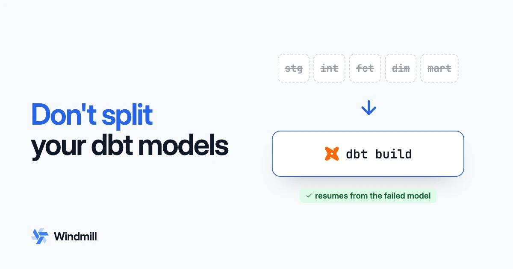

import DocCard from '@site/src/components/DocCard';

# How dbt works, and why orchestrators shouldn't split it into tasks



First post in a five-part series on data pipelines. This one is the primer: what dbt is architecturally, the five ways people run it in production, and why the arrangement that looks most sophisticated is the slowest and the most fragile.

Briefly, for anyone who has not used it: [dbt](https://www.getdbt.com/) is the transformation layer over a data warehouse. You write `select` statements as files, one per table you want to build, and each of those files is called a model. dbt wraps each model in the DDL that materializes it as a table or view, works out what order to run them in from the references between them, and sends the SQL to the warehouse to execute. A project is typically a few hundred models.

The counter-intuitive conclusion first: dbt should almost always run as one command, rather than split into one orchestrator task per model.

Splitting it up is tempting for two reasons, and both are worth wanting. You want to see which model failed without opening a log, and you want to retry that one model rather than the whole project. The argument of this post is that you get both more cheaply by keeping the record dbt already writes of what it ran, and reading it, than by turning two hundred models into two hundred tasks spread across workers.

That is not a contrarian take any more. It is where [Dagster](https://dagster.io/) started, and it is where [astronomer-cosmos](https://github.com/astronomer/astronomer-cosmos), the library that popularised one [Airflow](https://airflow.apache.org/) task per dbt model, ended up after measuring its own default at [roughly six times the cost of a single invocation](https://astronomer.github.io/astronomer-cosmos/guides/run_dbt/airflow-worker/watcher-execution-mode.html). What follows is why the appealing design loses, and what the two systems that converged on it still got wrong on the way.

{/* truncate */}

## What dbt actually is

Three things sharing a CLI.

A templating layer. A dbt model is a file containing a `select` statement with [Jinja](https://jinja.palletsprojects.com/) in it. `{{ ref('stg_orders') }}` is a macro call that returns the name of another model's relation. A whole model is just this:

```sql
-- models/marts/orders_daily.sql
{{ config(materialized='table') }}

select
    date_trunc('day', ordered_at) as day,
    count(*)                      as orders,
    sum(amount)                   as revenue
from {{ ref('stg_orders') }}
where status = 'paid'
group by 1
```

dbt renders the template, wraps the result in DDL, and sends the string to your warehouse. With the [BigQuery](https://cloud.google.com/bigquery) adapter and `materialized='table'`, what actually arrives is:

```sql
create or replace table `analytics`.`orders_daily` as (
    select
        date_trunc('day', ordered_at) as day,
        count(*)                      as orders,
        sum(amount)                   as revenue
    from `analytics`.`stg_orders`
    where status = 'paid'
    group by 1
);
```

The two things that changed are the two things dbt does: `ref('stg_orders')` became a real relation name, and the `select` got wrapped in the DDL its materialization implies. In dbt 1.x nothing in that path parses SQL, which is what post four in this series will take apart.

A dependency graph, derived for free. Because you had to write `ref()` to name another model, dbt can resolve every one of those calls at parse time and get a DAG out of it, with no annotation and no registry. This is the single best design decision in the tool, and it is why every integration in existence reads `manifest.json`.

A materialization compiler. `materialized='table'` compiles to `create table as select`. `view` to `create view`. `incremental` to a temp table plus a `merge`, or a `delete`+`insert`, or an `insert overwrite`, depending on the strategy and the adapter. `snapshot` to SCD2 bookkeeping. Each of these is written per warehouse dialect, in Jinja and SQL, in an adapter package.

One materialization matters later: `ephemeral` models are not built at all. dbt interpolates them into their dependents as a CTE prefixed `__dbt__cte__`. There is no object in the warehouse and no unit of work. A node in the manifest is not necessarily a thing that runs.

The artifacts land in `target/`. Two matter: `manifest.json`, the parsed project and its graph, and `run_results.json`, the record of what a given invocation actually did, node by node, with status and timing. `run_results.json` is the one that matters later.

And the architectural fact that everything else follows from: dbt does not process data. It generates SQL, sends it, and waits. dbt's own documentation is unusually clear on this: setting `threads: 8` means dbt will work on up to 8 models at once ["without violating dependencies"](https://docs.getdbt.com/docs/running-a-dbt-project/using-threads), bounded in practice by the available paths through the graph, and a thread is "an open connection to your data warehouse, not the number of parallel threads on your local machine's CPU".


## dbt is already an orchestrator

As a job description, that is an orchestrator. dbt has:

- a DAG, derived from the code rather than declared
- a topological scheduler over it
- a bounded work queue, `--threads`, whose unit is a warehouse connection
- failure semantics: a failed node's descendants are skipped, the rest of the graph continues
- a structured run log, `run_results.json`
- and a resume command, `dbt retry`, which reads that log and rebuilds only what the run left failed or skipped

`dbt build` additionally interleaves the other resource types: seeds, snapshots, models and tests, with a model's tests running immediately after that model rather than in a phase at the end.

So "orchestrating dbt" is never the act of scheduling dbt's work. dbt schedules its own work. It is the act of putting a second scheduler above an existing one, and every design question in this post is really the question of which of the two owns what.

## The five ways people run it

| Mode | What the orchestrator actually does | Where dbt's DAG lives |
| --- | --- | --- |
| Its own scheduler | nothing; cron, or a job in the dbt platform | in dbt |
| Trigger the vendor | fires an API call and polls (`DbtCloudRunJobOperator`) | in dbt |
| One opaque task | runs `dbt build` in a `BashOperator` or a pod | in dbt |
| Task per model | renders one task per manifest node, each running `dbt run --select` | duplicated in the orchestrator |
| One invocation, per-model status | runs `dbt build` once, then reads dbt's own event stream to show each model's state | in dbt; the orchestrator only mirrors it |

Modes one and two are the same shape: dbt owns everything, and your orchestrator is at best a trigger with a sensor attached. This is fine, and it is the right answer if dbt is the only thing in your stack. It stops being fine the moment a Python script has to run after the marts land, because now two systems each own a schedule and neither knows about the other's.

Mode three is the one everyone starts with. Call it the BashOperator outcome: dbt is one green square in the middle of your DAG. You get triggering, credentials and a place to hang alerts, and you get nothing else. Which model failed is a question you answer by reading the log. Which tables the run wrote is not represented anywhere. Lineage stops at the square's edge in both directions. It is a strictly worse version of mode one, with an extra system to operate.

Mode four is the reaction to that.

Mode five is where both Dagster and Cosmos ended up, by different routes and years apart. It keeps dbt's single invocation and gets the per-model view by reading what dbt already emits, rather than by rebuilding dbt's graph as tasks.

## Why task per model is so appealing

The motivations are all real:

- Per-model retry. A transient warehouse error on model 43 of 200 should cost you model 43, not the run.
- Per-model visibility. A failure should be legible from the orchestrator's UI without opening a log.
- One graph. Your dbt models and the Python job downstream of them should be nodes in the same picture.
- Heterogeneous placement. This model needs a big machine, that one needs to reach a private network.

Those are the right things to want. Cosmos's own documentation puts it plainly: task-per-model ["provides strong observability and task-level retry control"](https://astronomer.github.io/astronomer-cosmos/guides/run_dbt/airflow-worker/watcher-execution-mode.html).

The design that follows is mechanical. Read `manifest.json`, emit one Airflow task per node, wire the edges from `parent_map`, and have each task shell out to `dbt run --select that_model`. Cosmos calls this `ExecutionMode.LOCAL` and it is the default. There are variants that swap the process boundary for a heavier one: `VIRTUALENV` builds and tears down a Python environment per task, `KUBERNETES` spins a pod per task, and there are Docker, ECS, Cloud Run and Azure Container Instance flavours of the same idea.

## The cost: 1.7x slower, and 6x the process overhead

Cosmos benchmarked its own default and published the numbers, which is more than most vendors do. Two measurements, and they answer different questions. Both are public: the [process-overhead comparison](https://astronomer.github.io/astronomer-cosmos/guides/run_dbt/airflow-worker/watcher-execution-mode.html) and the [cluster benchmark](https://astronomer.github.io/astronomer-cosmos/guides/run_dbt/airflow-worker/watcher-benchmark.html), with the harness itself in [astronomer/cosmos-benchmark](https://github.com/astronomer/cosmos-benchmark).

The first isolates the process overhead, with no orchestrator involved at all. On [google/fhir-dbt-analytics](https://github.com/google/fhir-dbt-analytics), 185 models against BigQuery, run purely through the dbt CLI:

| Run type | Total runtime |
| --- | --- |
| a single `dbt run` | ~5m 30s |
| one `dbt run` per model | ~32m |

Roughly six times, before Airflow has scheduled anything. Cosmos's docs say this ["motivated a rethinking of how Cosmos interacts with dbt"](https://astronomer.github.io/astronomer-cosmos/guides/run_dbt/airflow-worker/watcher-execution-mode.html).

The second is the honest end-to-end comparison, because a real Airflow deployment runs those tasks concurrently rather than in sequence. On an Airflow 3.2 Helm deployment with 18 task slots, five repetitions per configuration, dated 2026-05-15:

| Mode | Wall time |
| --- | --- |
| task per model (`ExecutionMode.LOCAL`) | 8.9 ± 0.2 min |
| single invocation, `threads=8` (`ExecutionMode.WATCHER`) | 5.2 ± 0.2 min |

About 41% faster. Four mechanisms are behind the gap.

Every invocation re-pays the parse. `dbt run --select one_model` still needs the whole project's manifest, because `ref()` cannot resolve otherwise. Each task pays a process start, a project parse (or a restore of the `partial_parse.msgpack` cache, if the task happens to land somewhere that has one), an adapter import and a fresh warehouse connection, to run one statement.

You are distributing waiting, not work. dbt threads are warehouse connections, so the compute you are spreading across workers is almost entirely a network wait. The [benchmark's own analysis](https://astronomer.github.io/astronomer-cosmos/guides/run_dbt/airflow-worker/watcher-benchmark.html) is blunt about it: task-per-model "is bound by your data warehouse, not Airflow", its worker pool peaked at 4.30 of 9 available cores "because each dbt task spent most of its time waiting on BigQuery", and "adding more Airflow workers will not move that ceiling". Meanwhile the single `dbt build` doing all 185 models peaked at 0.83 of one core at `threads=16`, and dropped peak memory in the worker pool from 10.0 GiB to about 8.5 GiB by not running one dbt process per concurrent slot. Total CPU across the run actually goes up under watcher mode, 1887s to 2260s, because the per-model sensors do real Airflow-side work; what task-per-model buys with that saved CPU is a run that takes 1.7x longer and 1.1 GiB more memory. The unit you fanned out is not the unit that is scarce.

The graph you fanned out is not the graph dbt runs. Ephemeral models are CTEs with no task to schedule. Tests are nodes but their placement is a property of `dbt build`, not of the model graph. And once N independent processes each open their own connections, nothing holds a global view of warehouse concurrency: your `threads` setting has stopped meaning anything, and the real limit is now `parallelism` in a different system's config file. Two knobs, neither of them the one you think you are turning.

It shatters dbt's state. Each invocation writes its own `run_results.json` covering one node, so `dbt retry` has nothing coherent to resume from. The resume capability dbt ships is destroyed by the topology, and has to be rebuilt, worse, as orchestrator-level task retries.

## Everyone converged back

Dagster never fanned out in the first place. `@dbt_assets` maps a dbt project to Dagster assets, but a run selecting many of them issues a single CLI invocation with a combined selection, roughly `dbt run --select some_model another_model last_model`, and yields per-asset events from `.stream()` as they arrive. One process, many assets, per-asset materialization events. Splitting into separate invocations is something you have to deliberately construct with separate asset selections and jobs.

Cosmos got there from the other direction. `ExecutionMode.WATCHER`, experimental since 1.11.0 in late 2025 and stable as of 1.15.0 in July 2026, is built from two operators. A `DbtProducerWatcherOperator` runs dbt once over the whole pipeline with `--log-format json`, registers dbt's own event callbacks, and pushes per-node status into XComs. A `DbtConsumerWatcherSensor` per model watches those XComs and marks its Airflow task complete when the corresponding node finishes. The [stated goal](https://astronomer.github.io/astronomer-cosmos/guides/run_dbt/airflow-worker/watcher-execution-mode.html) is to combine "the speed of a single dbt run" with "the observability and task management of Airflow".

So the canonical task-per-model library now ships, as its recommended fast path, a mode whose entire purpose is to not run one task per model.

Kestra never split it either. Its [`DbtCLI`](https://kestra.io/plugins/plugin-dbt/dbt-cli/io.kestra.plugin.dbt.cli.dbtcli) task runs the command once and parses `manifest.json` and `run_results.json` afterwards, so the per-model view in the Gantt chart is reconstructed from dbt's own artifacts rather than from a task per node. Same shape, arrived at independently.

### The retry history

Cosmos maintains a [retry behaviour history](https://astronomer.github.io/astronomer-cosmos/guides/run_dbt/airflow-worker/watcher-retry-history.html) for watcher mode, which is unusually frank for vendor documentation: it tracks the behaviour release by release and says plainly where its own versions got it wrong. It explains that the mode stayed experimental for months because it "is based on non-idempotent Apache Airflow tasks and relies on a complex retry mechanism in which one task's status can affect another task's status".

The version-by-version table of "does the Airflow state match dbt's?" answers yes for 1.11 through 1.12.1, then "maybe" for 1.13, then, for 1.14.0:

> No. On producer retry, dbt model failures from the first attempt are silently dropped. The consumer tasks for those models are marked successful instead of running their fallback retry, so the DAG appears successful even though dbt failed.

A false green. The worst failure an orchestrator has.

Fixed in 1.14.1, with a further "false green" gap around `upstream_failure` skips closed in 1.14.2. There is a config, `enable_watcher_reliable_retry`, that exists solely because XComs are cleared on retry and the per-node status buffer therefore has to be mirrored into an Airflow Variable to survive.

This is not a criticism of Cosmos. Shipping the fix, the history and the failure table is the correct behaviour and most projects would have quietly bumped a version number. The point is what the difficulty was.

The expensive part was never running dbt in one process. It was insisting that the orchestrator's task state be a *replica* of dbt's node state. Two systems, each with its own persistence, retry rules and idempotency assumptions, holding two copies of one truth. That is a distributed state problem, and you buy it in full whether or not you also fanned out the processes.

## Durable execution, and a display problem

Strip the two goals back and they are:

1. When a run fails partway, resume it rather than restart it.
2. While it runs, and after it fails, see per-model status without reading a log.

The second is a display problem. dbt emits structured node events on a stream; read them and draw them. It requires no topology at all.

The first is durable execution: the run's progress is written somewhere that outlives the process running it, so a failure resumes from the last checkpoint instead of from the beginning. And the useful observation is that dbt already ships both halves. `run_results.json` is the checkpoint, and `dbt retry` is the resume, rebuilding the nodes the previous invocation left failed or skipped rather than re-running their successful ancestors.

The durability boundary is the same in both designs. Each dbt model is its own committed statement in the warehouse. If a worker dies mid-run, the models that finished are committed, and the in-flight ones are not, and that is true whether the run was one process or two hundred. Fanning out buys you exactly zero additional durability at the warehouse. All it changes is where the record of "which ones finished" lives, and task-per-model puts that record in the orchestrator's task table, which is precisely the copy that can disagree with dbt.

![Task per model versus one invocation, and what changes between them: on the left four separate dbt run processes each write their own run_results file covering a single node, with the record of what finished landing in the orchestrator's task table, a second copy that can disagree with dbt; on the right one dbt build writes a single run_results.json covering every node into persisted dbt state, one source of truth that survives the worker; both converge on the same warehouse, where each model is its own committed statement either way, so fanning out adds no durability](./durability_boundary.webp 'Fanning out changes where the record of what finished lives, not the durability boundary at the warehouse')

Do not replicate dbt's state into task state. Persist dbt's own state, somewhere that survives the worker, and project it for display.

| | Task per model | One job, durable |
| --- | --- | --- |
| Process boundaries per run | one per node | one |
| Parse cost | once per node | once |
| Warehouse concurrency | set in two places, honoured in neither | dbt's `threads` |
| Per-model status | task state, a second copy of dbt's | read from dbt's event stream |
| Resume | orchestrator retries a task | `dbt retry` from `run_results.json` |
| Source of truth | two, reconciled | one |

The one thing genuinely lost is heterogeneous placement per model. If one model truly needs a different machine than the others, one job cannot give you that.

With a warehouse adapter it matters less than it sounds, because the model is not running on your machine in the first place: it is a `select` executing in [Snowflake](https://www.snowflake.com/) or BigQuery while your worker holds a connection open. Where that worker sits changes nothing the warehouse has not already decided.

With an in-process engine like `dbt-duckdb` the work really is on the node, and the thing being asked for is data locality: run the compute where the bytes are. That is worth wanting, but pinning individual models to machines is a blunt way to get it. Putting the data in the same region, or on something like [S3 Express One Zone](https://aws.amazon.com/s3/storage-classes/express-one-zone/), moves the bytes closer without fragmenting the run, and it keeps working when the graph changes shape. Where placement genuinely does bite, the unit is a group of models rather than one, which is a project boundary.

There is a larger point for [DuckDB](https://duckdb.org/) specifically. [`dbt-duckdb`](https://github.com/duckdb/dbt-duckdb) works, but it applies dbt's warehouse-shaped model to an engine that has its own: [DuckLake](https://ducklake.select/) offers transactions, snapshots and partition rewrites that per-dialect Jinja materializations were never built to reach for. An orchestrator that leans on those directly is a different design, and it is the one we ended up building for [pipelines](/docs/core_concepts/pipelines). For a team already on dbt, running it on DuckDB is a reasonable stepping stone rather than the destination.

### The case for splitting it anyway

Prefect went the other way. In May 2026 they shipped a [dbt Orchestrator](https://www.prefect.io/blog/dbt-orchestrator), still open beta, that "executes your dbt graph model by model", alongside the single-invocation runner they already had. Mage's dbt blocks are per-model too.

Two things make their version cheaper than the naive one. The nodes run in a shared process pool rather than a pod each, which takes most of the startup tax out of the first table. And each model's SQL, config and dependencies get hashed, so a rerun skips what has not changed. `dbt build` gives you nothing like that on its own.

That answers process overhead. It does not answer state. A process pool does not move the record of which models finished, and under `PER_NODE` that record is Prefect's task table, sitting next to dbt's `run_results.json` and free to disagree with it. Cosmos spent four releases and a public failure table on that problem. Prefect's announcement does not mention it.

The caching is the orchestrator reaching for a job the engines are taking back. dbt already ships `state:modified` with deferral, and Fusion and SQLMesh work out what to rebuild by diffing parsed SQL, which beats hashing text: reformat a model and the hash changes, the parse does not.

None of that makes it a bad bet. Prefect looked at the same trade and decided the caching is worth a second copy of the truth. We think it is not.

## What we built

Windmill's [dbt runtime](/docs/getting_started/scripts_quickstart/dbt) runs an unmodified dbt project as one job per invocation, which makes it a test of whether those two halves really do separate.

The display half reads rather than reconstructs: the worker tails dbt's own event stream and animates the project's graph as it builds, so per-model status costs no tasks. Every node ends with its status, timing and dbt's own message, which is what makes a partial failure legible without opening the log.

The durability half persists dbt's state rather than a copy of it: `run_results.json` is stored outside the job directory, so `dbt retry` rebuilds what the last attempt left failed or skipped from any worker, not only the one that died.

We got two things wrong before we got them right, and both are the kind of thing you only find by shipping it. A retry's `run_results.json` names only the nodes it redid, so it has to be overlaid on the accumulated results rather than replace them, or everything that succeeded before the retry silently vanishes from the job's result. And a retry has to name the run it resumes rather than resolving "the last failure" when it runs, or it quietly resumes a different run than the one you were looking at.

One limitation comes from dbt rather than from the design: it takes no cross-process lock, so two concurrent builds of a project can rebuild the same incremental model twice. The fix is a [concurrency limit](/docs/core_concepts/concurrency_limits) on the script, and a task topology would not have fixed it either.

## Where the line ends up

dbt owns ordering and parallelism within the project. It has the graph, it has the only correct view of warehouse concurrency, and it has the resume primitive.

The orchestrator owns triggering, credentials, worker placement, observability, recovery, cross-tool lineage, and everything that is not SQL: the ingestion before the project and the notification, export or Python job after it.

The failure mode of most dbt integrations is trying to take the first list off dbt, at considerable expense, and then not doing a very good job of the second. An orchestrator whose pitch is "we render your dbt project as per-model tasks" is competing on the half dbt already does well, and, as post four will get into, on the half that is about to shrink further as the transform engines learn to decide what needs rebuilding at all.

The recommendation at the top follows from that division. Run dbt as one command, and read the file it leaves behind: per-model status and per-model retry are both in `run_results.json` already, and the topology that promises them is the one thing that destroys it.

## What wrapping cannot buy

Everything above is the best you can do while dbt owns the transform, and the ceiling is set by what dbt was built for. dbt is a warehouse tool. It assumes the compute is somewhere else, expensive and per-vendor, so it generates SQL per dialect, ships it, and waits. The rest follows from that. The model is the unit because a model is one `create table as` you send to Snowflake. Materialization is Jinja per adapter because every warehouse spells `merge` differently. `manifest.json` records model-to-model edges rather than column-to-column ones because nothing in dbt 1.x parses the SQL it sends. An orchestrator wrapping dbt inherits all of it: it can read dbt's state, it cannot change what dbt's state is about.

DuckDB and DuckLake change the assumption underneath. The compute is in-process rather than a vendor endpoint, and DuckLake is a real table format, so transactions, snapshots and partition rewrites are things the storage layer already does rather than things a template emulates per dialect. That makes a different design available: one script per asset is one job, so per-model retry and status cost nothing extra; lineage is parsed from the SQL, so it reaches columns; materialization is a property of the format rather than a template per warehouse. That is the [pipelines model](/docs/core_concepts/pipelines).

`dbt-duckdb` sits between the two, and awkwardly. It runs dbt's warehouse-shaped model on an engine that does not need most of it: you still get per-dialect materializations and a graph that stops at table edges, but the reason those existed, an expensive vendor engine on the far side of a network, is gone.

We built the pipelines model first, and the feedback we got back was consistent and was not about the model: a team with a working dbt project is not going to rewrite it to get those properties, however good they are. So the dbt runtime is the middle ground, and for most teams it is the right one. Keep the project, get the orchestration half done properly, and take the deeper model where a pipeline is new rather than migrated.

## Next

Post two, coming next, is on asset graphs and lineage: why dbt, Dagster, Airflow and OpenLineage each identify a table differently, why that means your lineage graph has a hole in it that looks like a working answer, and what identity has to be keyed on instead.

<div className="grid grid-cols-2 gap-6 mb-4">
	<DocCard
		title="dbt on Windmill"
		description="Run an unmodified dbt project as a script, with live per-model progress and dbt retry."
		href="/docs/getting_started/scripts_quickstart/dbt"
	/>
	<DocCard
		title="Assets"
		description="How Windmill infers reads and writes from code and builds the lineage graph."
		href="/docs/core_concepts/assets"
	/>
</div>
