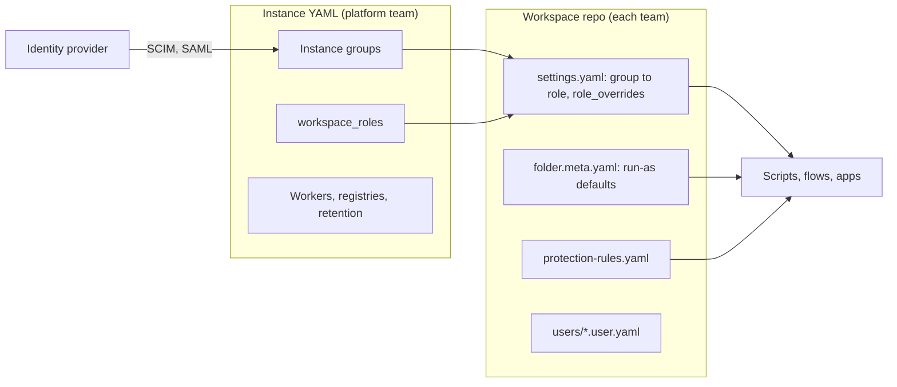

import DocCard from '@site/src/components/DocCard';

# Governance for your automation platform, in a git repo

Every security review of an automation platform asks the same three questions.
Who can change what?
When a job touches production, whose credentials does it use?
And how does a change get there?

On most platforms the answers live in an admin UI, spread across a dozen settings pages, and the audit trail is whoever remembers clicking them.
In Windmill they're files.
Roles, the mapping from your identity provider to those roles, the identity every job runs as and the rules on how changes ship are all YAML, reviewed in pull requests and applied by CI.
Policy as code, applied to the platform that runs your automation rather than only to the infrastructure it touches.

This post walks through those files, layer by layer, and says plainly what is still configured in the UI and what needs [Enterprise Edition](/pricing).

{/* truncate */}

## Two owners, two sets of files

Governance in Windmill splits along the same line as ownership.
The platform team owns the instance: identity, the definition of each role, where code runs and what it can install.
Each team owns its workspace: which group gets which role there, what its jobs run as, and how changes reach it.



The instance side is one YAML document with a `global_settings` section and a `worker_configs` section.
You apply it with `wmill instance push`, with the `windmill sync-config` command on any deployment, or with the Kubernetes operator, which reconciles the database against a `WindmillInstance` spec every five minutes and reverts edits made in the UI.
The operator ships with the Enterprise Edition image.

The workspace side is the repo [`wmill sync`](/docs/advanced/cli/sync) and [git sync](/docs/advanced/git_sync) already keep: scripts, flows and apps, plus `settings.yaml`, folder metadata, users, groups and protection rules.

## Who exists, and what a role means

Identity starts in your identity provider.
[SCIM](/docs/advanced/saml_and_scim#scim) provisions users and groups into Windmill instance groups, and [SAML](/docs/advanced/saml_and_scim#saml) or OIDC signs them in.
The SCIM token and the SAML metadata are instance settings like any other, so the connection itself is in the file.

An instance group can carry an instance role, `superadmin` or `devops`, so membership in your identity provider decides who administers the platform.
`wmill instance push` syncs instance groups with that role, their SCIM identifiers and their members.

What a workspace role allows is also defined once, for the whole instance, in the `workspace_roles` setting.
Each role is a name, a label and a set of capabilities.
The order ranks them, highest first:

```yaml
global_settings:
  workspace_roles:
    - name: developer
      label: Developer
      capabilities:
        code: true
        flows: full
        apps: full
    - name: builder
      label: Builder
      capabilities:
        code: false
        flows: compose
        apps: compose
    - name: operator
      label: Operator
      capabilities:
        code: false
        manage_schedules: false
        manage_triggers: false
```

A `builder` here assembles flows and apps from scripts that are already deployed, without writing code of its own.
The server enforces it: a composed flow with an inline script is refused, and a composed full-code app always deploys with [sandbox isolation](/docs/full_code_apps/sandbox_isolation).
The full list of capabilities is on the [roles and permissions](/docs/core_concepts/roles_and_permissions#capabilities) page.
Custom roles need an Enterprise license.
Without one, the two default roles, developer and operator, stay available.

## Who gets which role, per workspace

Each workspace maps instance groups to roles in its `settings.yaml`:

```yaml
auto_invite:
  instance_groups:
    - platform
    - finance-analysts
  instance_groups_roles:
    platform: admin
    finance-analysts: builder
```

Add someone to `finance-analysts` in your identity provider and they show up in this workspace as a builder on the next SCIM cycle.
Remove them and they're gone from every workspace the group maps to.

A workspace can also tighten or loosen a role for itself, or add a role of its own, under `role_overrides`.
Only the capabilities it states change; the rest keep following the instance definition:

```yaml
role_overrides:
  operator:
    capabilities:
      visibility:
        audit_logs: false
  reviewer:
    label: Reviewer
    capabilities:
      code: false
```

Members added by hand are files too, one per user under `users/`, with `role` naming the workspace role, or `admin`.

{/* TODO before publishing: `role_overrides` in settings.yaml and custom role names in users/*.user.yaml land with windmill-labs/windmill#12139. Name the Windmill and CLI version here once released. */}

## What runs as whom

A role decides what someone can author.
It doesn't decide what a job can reach once it runs.
That's the identity the job is [permissioned as](/docs/core_concepts/roles_and_permissions#run-on-behalf-of): a job only reads the resources, variables and folders that identity can, and the audit log attributes the run to it.

By default a deployed item runs as whoever deployed it.
On a CI deploy, that's the token behind `WMILL_TOKEN`, which is rarely what you want for a nightly job that writes to the finance database.
A folder can set the default instead, in its `folder.meta.yaml`:

```yaml
# f/finance/folder.meta.yaml
default_permissioned_as:
  - path_glob: 'ledger/**'
    permissioned_as: u/finance_ledger_svc
  - path_glob: '**'
    permissioned_as: g/finance
```

The first matching glob wins.
The default applies when an admin or a member of `wm_deployers` creates the item, and only when the item doesn't already name an identity.
Committed per workspace, the same folder can run as a staging service account in staging and a production one in production.
The [deployment stages guide](/docs/advanced/canonical_deployment_setups#stage-4--add-multi-workspace-promotion) shows that setup end to end.

## Where code runs and what it can install

The instance file also decides where code runs and what it pulls in.
[Worker groups](/docs/core_concepts/worker_groups) and their tags pin a team's jobs to its own machines, and package registries point every dependency install at your mirror.
Two settings add a waiting period on new packages, in seconds, so a compromised release has time to be caught and yanked before your workers install it:

```yaml
global_settings:
  pip_index_url: "https://pypi.internal.example.com/simple"
  npm_config_registry: "https://npm.internal.example.com"
  uv_exclude_newer: 604800              # Python: nothing published in the last 7 days
  bun_install_min_release_age: 604800   # Bun: same rule for npm packages
  retention_period_secs: 2592000        # job history kept 30 days
  audit_log_retention_days: 365
```

Raising the wait from seven days to fourteen is a one-line diff with a reviewer on it, rather than a toggle someone flipped on a Friday.

## How a change lands

The last layer governs change itself.
[Protection rulesets](/docs/core_concepts/protection_rulesets) can turn off direct deployment, turn off forking or restrict public sharing, with named groups or users allowed to bypass them.
They live in `protection-rules.yaml`, keyed by workspace and synced with `wmill protection-rules pull` and `push`:

```yaml
prod:
  - name: prod-lock
    rules:
      - DisableDirectDeployment
      - RestrictPublicRunSharing
    bypass_groups: []
    bypass_users: []
```

With direct deployment off and no bypass group, changes reach `prod` only through a fork merge, a git sync pull request or a promotion from staging.
That holds for the governance files themselves: a pull request that grants the `builder` role the `code` capability goes through the same review as one that changes a flow.
Git sync pull requests and deployment requests can get an [AI review](/docs/advanced/workspace_forks#ai-review) that follows your own instructions, so "flag any change to `role_overrides` or `default_permissioned_as`" is a rule you write once.

In CI, `wmill workspace apply-settings settings.yaml --dry-run` prints what would change before anything does, and the merge applies it.
On the instance side, the operator reports whether the last reconciliation succeeded on the `WindmillInstance` status.
The [audit logs](/docs/core_concepts/audit_logs), queryable with `wmill audit list`, record who applied what.

## What still needs the UI or a license

A few things aren't files yet, and a few need Enterprise Edition.

- An admin's underlying role isn't in `user.yaml`: admins hold every capability, so the file just says `admin`.
- Custom instance roles, workspace-only roles, SAML, SCIM, instance group mapping to workspaces, protection rulesets, the Kubernetes operator and full audit logs need Enterprise Edition.
- Overriding the two default roles per workspace, folder run-as defaults, worker tags, registries and `sync-config` work on every edition.

Most of the work of governing an automation platform is answering "who changed this, and who approved it" months later.
When the answer is a commit and a pull request, you can just look it up.

<div className="grid grid-cols-2 gap-6 mb-4">
	<DocCard
		title="Infrastructure as code"
		description="Manage instance configuration with YAML, a Kubernetes operator or the CLI."
		href="/docs/core_concepts/infrastructure_as_code"
	/>
	<DocCard
		title="Roles and permissions"
		description="Workspace roles, capabilities, instance groups and run on behalf of."
		href="/docs/core_concepts/roles_and_permissions"
	/>
	<DocCard
		title="Collaboration and deployment stages"
		description="From a shared workspace to forks, git sync and multi-workspace promotion."
		href="/docs/advanced/canonical_deployment_setups"
	/>
	<DocCard
		title="Let business teams build with AI safely"
		description="Combine roles, forks, review and dedicated workers."
		href="/docs/advanced/ai_guardrails"
	/>
</div>
