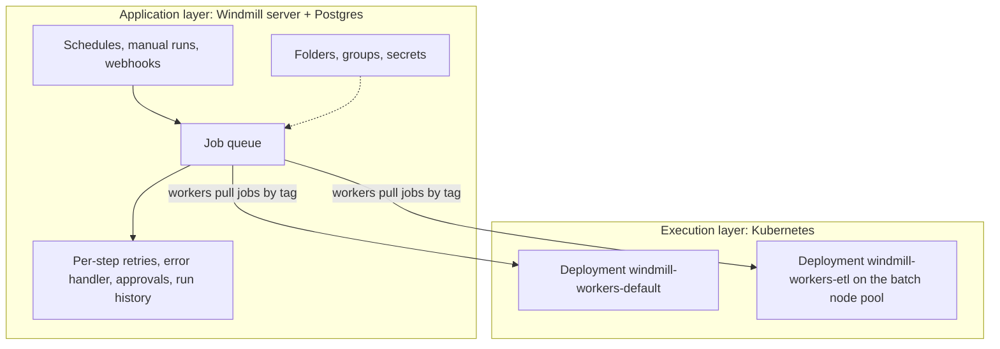

import DocCard from '@site/src/components/DocCard';

A CronJob that runs one container on a schedule is one of the better deals in Kubernetes.
Fifteen lines of YAML, a `backoffLimit`, and the cluster handles scheduling, retries and cleanup.
The trouble starts at the second step.

This post builds a four-step nightly pipeline with nothing but Jobs, CronJobs, Secrets and ConfigMaps, as well as we know how, and marks where it runs out.
Then it builds the same pipeline on [Windmill](/), deployed on the same cluster with its Helm chart.
We make Windmill, so read the second half with that in mind; the first half stands on its own.

{/* truncate */}

## The pipeline

Every night at 02:00, for the previous day:

1. Extract: an in-house exporter image, `registry.internal/data/orders-export:3.2`, pulls orders from the orders API and writes them as JSON lines.
2. Transform: a Python script drops test orders and duplicates, and converts totals to cents.
3. Load: a Python script replaces that day's rows in the `orders_daily` table of a Postgres warehouse.
4. Notify: a message to a Slack channel.

Nothing exotic.
Most batch work on Kubernetes looks like this: a few steps, some credentials, a file handed from one step to the next.

## Built with Jobs and CronJobs

Kubernetes has no notion of a step, but it has one ordered construct: init containers.
They run one after another, each must exit 0 before the next starts, and the regular containers start only after all of them succeed.
They also share the pod's volumes, so an `emptyDir` can carry the file from one step to the next.
That makes one pod with three init containers and a final container the closest native shape to a pipeline:

```yaml
apiVersion: batch/v1
kind: CronJob
metadata:
  name: orders-nightly
  namespace: data
spec:
  schedule: "0 2 * * *"
  timeZone: "Europe/Paris"
  concurrencyPolicy: Forbid          # never two runs at once
  startingDeadlineSeconds: 3600      # skip a run that couldn't start within the hour
  successfulJobsHistoryLimit: 3
  failedJobsHistoryLimit: 3          # default is 1
  jobTemplate:
    spec:
      backoffLimit: 4                # retry budget for the whole Job
      activeDeadlineSeconds: 7200    # hard cap, retries included
      ttlSecondsAfterFinished: 172800
      template:
        spec:
          restartPolicy: OnFailure   # restart the failed container in place
          volumes:
            - name: work
              emptyDir: {}
            - name: scripts
              configMap:
                name: orders-etl-scripts   # transform.py and load.py
          initContainers:
            - name: extract
              image: registry.internal/data/orders-export:3.2
              args: ["--day", "yesterday", "--out", "/work/orders.jsonl"]
              envFrom:
                - secretRef:
                    name: orders-api
              volumeMounts:
                - { name: work, mountPath: /work }
            - name: transform
              image: python:3.12-slim
              command: ["python", "/scripts/transform.py", "/work/orders.jsonl", "/work/clean.jsonl"]
              volumeMounts:
                - { name: work, mountPath: /work }
                - { name: scripts, mountPath: /scripts }
            - name: load
              image: registry.internal/data/etl-python:1.8   # python + psycopg
              command: ["python", "/scripts/load.py", "/work/clean.jsonl"]
              envFrom:
                - secretRef:
                    name: warehouse
              volumeMounts:
                - { name: work, mountPath: /work }
                - { name: scripts, mountPath: /scripts }
          containers:
            - name: notify
              image: curlimages/curl:8.10.1
              command:
                - sh
                - -c
                - >-
                  curl -fsS -X POST -H 'Content-Type: application/json'
                  -d '{"text":"orders-nightly: load done"}' "$SLACK_WEBHOOK_URL"
              env:
                - name: SLACK_WEBHOOK_URL
                  valueFrom:
                    secretKeyRef: { name: slack, key: webhook }
```

The scripts live in a ConfigMap, the credentials in three Secrets, and `restartPolicy: OnFailure` means a failed `load` is restarted by the kubelet inside the same pod, with `/work/clean.jsonl` still on disk.
Extract doesn't run again.
For a pipeline this size, that's a reasonable piece of engineering, and it's what we'd ship if Kubernetes primitives were the only option.

## Where it runs out

### Steps are a side effect of init containers

Init containers give you a straight line.
There's no fan-out (load into two warehouses in parallel), no conditional step (skip the load when the export is empty), and no step that runs only when another one fails.
All steps also land on one node, since they're one pod.

Splitting the steps into separate Jobs fixes the shape but removes the ordering: Kubernetes has no dependency between Jobs.
Something has to watch for one Job to complete and create the next, and that something is an orchestrator.

### Data passes through a disk that dies with the pod

The `emptyDir` survives a container restart, not a new pod.
If the node is drained mid-run, or you switch to `restartPolicy: Never`, the next attempt is a fresh pod and the pipeline starts again from extract.
With separate Jobs, the handoff moves to a PersistentVolumeClaim (`ReadWriteMany` if the steps can land on different nodes) or to object storage, plus a naming convention and a cleanup policy for the files.

### One retry budget for the whole pipeline

`backoffLimit` belongs to the Job, not to a step.
With `OnFailure`, it counts container restarts across every container in the pod, so four flaky attempts at extract use up the budget the load step needed.
You can't say "retry the load five times with exponential backoff, and the extract twice after a minute"; the delay between attempts is the kubelet's back-off, not yours.

[`podFailurePolicy`](https://kubernetes.io/docs/concepts/workloads/controllers/job/#pod-failure-policy) gets closer: it can fail the Job right away on a given exit code, or ignore failures caused by disruptions.
It requires `restartPolicy: Never`, which brings back restart-from-scratch.

There's also no failure branch.
`notify` runs only when every init container succeeded.
To hear about a failure, you add an alert on `kube_job_status_failed` from kube-state-metrics, which tells you a Job failed, not which step or why.

### Logs live as long as the pod

`kubectl logs` reads from the pod.
`ttlSecondsAfterFinished` deletes the Job and its pods, and so does the CronJob's history limit, which keeps one failed Job by default.
With `OnFailure`, the [Kubernetes docs](https://kubernetes.io/docs/concepts/workloads/controllers/job/#pod-backoff-failure-policy) themselves point out that the pod is terminated once the backoff limit is reached, which makes the failure harder to debug, and suggest `Never` or a logging system.
In practice, the run history is whatever your log shipping kept, and finding the run of November 16 means knowing its pod name.

### Rerunning a day takes kubectl and a text editor

The analyst who noticed that November 16 looks wrong can't fix it.
Someone with `create` on Jobs in the `data` namespace runs:

```bash
kubectl create job --from=cronjob/orders-nightly orders-rerun-1116 -n data
```

That copies the template as is, with `--day yesterday`.
There's no flag to change the arguments, so a rerun for a specific day goes through `--dry-run=client -o yaml`, an edit, and `kubectl apply`.
A week of backfill is a shell loop.
There's no form, no approval before a production backfill, and no record of who ran what besides the API server audit log, if it's enabled.

### Secrets follow the namespace, not the team

RBAC can restrict who reads a Secret by name, but as the [Kubernetes docs](https://kubernetes.io/docs/concepts/security/secrets-good-practices/) put it, anyone who can create a pod in a namespace can use that pod to read any Secret in it.
"Finance can run their pipeline with the warehouse credentials but can't read them, and can't touch marketing's" turns into one namespace per team, and still no way to run without being able to read.

### Concurrency stops at one CronJob

`concurrencyPolicy: Forbid` stops two runs of `orders-nightly` from overlapping.
It says nothing about the three other CronJobs that write to the same warehouse.
[Kueue](https://kueue.sigs.k8s.io/) adds queueing and quotas for Jobs, expressed in cluster resources (CPU, memory, GPUs), not in "at most two jobs talk to the warehouse at a time".

Each of these has a workaround.
Put together, the workarounds are an orchestrator you maintain yourself: something that knows the steps, the inputs, who may run what, and what happens on failure.
Kubernetes is a good execution layer, and that missing piece is an application layer on top of it.

## Tools that already fill the gap

[Argo Workflows](https://argoproj.github.io/workflows/) is the Kubernetes-native answer.
Workflows are CRDs; steps form a DAG of templates, each with its own `retryStrategy` and backoff; files move between steps as artifacts in S3 or GCS; an `onExit` handler runs on failure; `CronWorkflow` schedules them, a `suspend` template waits for a human, and there's a UI to submit with parameters and read logs.
Each step is a pod, which gives every step its own image and resource requests, at the cost of a pod start per step.
If your team thinks in containers and writes YAML, it's a strong fit.

Airflow with the [KubernetesPodOperator](https://airflow.apache.org/docs/apache-airflow-providers-cncf-kubernetes/stable/operators.html) takes the other route: Airflow owns dependencies, per-task retries, failure callbacks, catchup and backfill, and the UI, while each task runs in its own pod.
Small results come back through XCom, read from `/airflow/xcom/return.json` by a sidecar.
You run Airflow's scheduler and metadata database, and pipelines are Python DAG files.

Windmill makes a different split, which the rest of this post shows.

## The same pipeline on Windmill, on the same cluster

Windmill's server holds the queue (in Postgres), the schedules, the permissions and the UI.
Workers are long-lived pods that pull jobs from that queue and run each step as a process, so a step doesn't wait for a pod to be scheduled.
Kubernetes still decides where workers run and how many there are.



### Deploy it with Helm

The [Helm chart](/docs/advanced/self_host) renders one Deployment per worker group, named `windmill-workers-<group>`, each with its own `nodeSelector`, `tolerations`, resources, image and service account.
Here the pipeline gets an `etl` group pinned to a batch node pool:

```yaml
# values.yaml
windmill:
  baseDomain: windmill.internal
  workerGroups:
    - name: default
      replicas: 3
    - name: etl
      replicas: 2
      nodeSelector:
        pool: batch
      tolerations:
        - key: dedicated
          operator: Equal
          value: batch
          effect: NoSchedule
      resources:
        requests: { cpu: "1", memory: 2Gi }
        limits: { memory: 4Gi }
      extraEnv:
        - name: WORKER_TAGS
          value: etl
        - name: DISABLE_NSJAIL      # run this group's jobs under nsjail
          value: "false"
```

```bash
helm repo add windmill https://windmill-labs.github.io/windmill-helm-charts/
helm install windmill windmill/windmill -n windmill --create-namespace --values values.yaml
```

Steps tagged `etl` only run on those pods.
The tags a group listens to can also be edited from the Workers page instead of the environment ([worker groups](/docs/core_concepts/worker_groups)).

Replica counts can stay fixed, or, on [Enterprise Edition](/pricing), Windmill's [native Kubernetes autoscaling](/docs/core_concepts/autoscaling) scales each worker Deployment between a minimum and a maximum based on queue load.
Set `autoscalingManaged: true` on the group so `helm upgrade` doesn't reset the replica count, and `enterprise.createKubernetesAutoscalingRolesAndBindings: true` for the RBAC that lets the server scale the Deployment.
When it scales in, it marks idle pods with a lower `pod-deletion-cost` so a worker in the middle of a job isn't the one removed.

### The flow

The pipeline is a flow: a YAML file plus one file per step, synced with the [CLI](/docs/advanced/cli) or edited in the flow editor.

```yaml
# f/etl/orders_nightly.flow/flow.yaml
summary: Nightly orders ETL
schema:
  type: object
  properties:
    day:
      type: string
      format: date
      description: Day to load. Empty means yesterday.
value:
  modules:
    - id: resolve_day
      value:
        type: rawscript
        language: bun
        content: '!inline resolve_day.ts'
        input_transforms:
          day: { type: javascript, expr: flow_input.day }
    - id: extract
      retry:
        constant: { attempts: 2, seconds: 60 }
      value:
        type: rawscript
        language: bash
        tag: etl
        content: '!inline extract.sh'
        input_transforms:
          day: { type: javascript, expr: results.resolve_day }
          api_token: { type: static, value: '$var:f/etl/orders_api_token' }
          aws_key_id: { type: static, value: '$var:f/etl/aws_key_id' }
          aws_secret: { type: static, value: '$var:f/etl/aws_secret' }
    - id: transform
      value:
        type: rawscript
        language: python3
        tag: etl
        content: '!inline transform.py'
        input_transforms:
          raw_key: { type: javascript, expr: results.extract }
          day: { type: javascript, expr: results.resolve_day }
    - id: load
      retry:
        exponential: { attempts: 5, multiplier: 2, seconds: 3 }
      value:
        type: rawscript
        language: python3
        tag: etl
        content: '!inline load.py'
        input_transforms:
          file: { type: javascript, expr: results.transform.file }
          day: { type: javascript, expr: results.resolve_day }
          warehouse: { type: static, value: '$res:f/etl/warehouse' }
    - id: notify
      value:
        type: rawscript
        language: python3
        content: '!inline notify.py'
        input_transforms:
          text: { type: javascript, expr: '`orders ${results.resolve_day}: ${results.load} rows loaded`' }
  failure_module:
    id: failure
    value:
      type: rawscript
      language: python3
      content: '!inline notify.py'
      input_transforms:
        text: { type: javascript, expr: '`orders_nightly failed at ${error.step_id}: ${error.message}`' }
```

Each step declares its own retries: two constant attempts a minute apart for the extract, and exponential backoff for the load, where the n-th retry waits `multiplier * seconds^n` (6, 18, 54, 162 and 486 seconds).
A retried step reruns alone, with the same inputs; the steps before it aren't touched ([retries](/docs/flows/retries)).
When retries run out, the `failure` module gets the error, including the id of the step that failed ([error handler](/docs/flows/flow_error_handler)).

The steps are plain functions:

```ts
// resolve_day.ts
export async function main(day?: string) {
  return day || new Date(Date.now() - 86_400_000).toISOString().slice(0, 10)
}
```

```python
# transform.py
import json
import wmill
from wmill import S3Object

def main(raw_key: str, day: str):
    seen, rows = set(), []
    for line in wmill.load_s3_file(S3Object(s3=raw_key)).decode().splitlines():
        order = json.loads(line)
        if order["id"] in seen or order["status"] == "test":
            continue
        seen.add(order["id"])
        rows.append({
            "id": order["id"],
            "customer_id": order["customer"]["id"],
            "total_cents": round(order["total"] * 100),
            "day": day,
        })
    body = "\n".join(json.dumps(r) for r in rows).encode()
    file = wmill.write_s3_file(S3Object(s3=f"clean/{day}.jsonl"), body)
    return {"file": file, "rows": len(rows)}
```

```python
# load.py
import json
from typing import TypedDict
import psycopg
import wmill
from wmill import S3Object

class postgresql(TypedDict):
    host: str
    port: int
    user: str
    dbname: str
    password: str

def main(file: S3Object, day: str, warehouse: postgresql):
    rows = [json.loads(l) for l in wmill.load_s3_file(file).decode().splitlines()]
    with psycopg.connect(
        host=warehouse["host"], port=warehouse["port"], user=warehouse["user"],
        dbname=warehouse["dbname"], password=warehouse["password"],
    ) as conn:
        conn.execute("delete from orders_daily where day = %s", (day,))
        with conn.cursor() as cur:
            cur.executemany(
                "insert into orders_daily (id, customer_id, total_cents, day) "
                "values (%(id)s, %(customer_id)s, %(total_cents)s, %(day)s)",
                rows,
            )
    return len(rows)
```

```python
# notify.py
import requests
import wmill

def main(text: str):
    requests.post(wmill.get_variable("f/etl/slack_webhook"), json={"text": text}, timeout=10)
```

Dependencies are inferred from the imports and locked when the flow is deployed, so there's no `etl-python` image to build and tag.
`warehouse` is a [resource](/docs/core_concepts/resources_and_types) passed in by path; the script never sees where it's stored.

Data moves differently than in the CronJob.
Small results (`rows`, the day) go from step to step as JSON through the queue.
The files go through the workspace's [object storage](/docs/core_concepts/object_storage_in_windmill), because consecutive steps can run on different worker pods.
Windmill has a shared-directory mode that keeps a flow on one worker with a common `./shared` folder, but it can't be combined with per-step retries, so for this pipeline the bucket is the right handoff.
On the Community Edition, workspace object storage is capped at 10 GiB per workspace.

### Keeping the image you already have

The exporter stays a container.
A Bash step with a `# sandbox <image>` annotation runs its body inside that image:

```bash
# extract.sh
# sandbox registry.internal/data/orders-export:3.2
day="$1"
api_token="$2"
aws_key_id="$3"
aws_secret="$4"
ORDERS_API_TOKEN="$api_token" AWS_ACCESS_KEY_ID="$aws_key_id" AWS_SECRET_ACCESS_KEY="$aws_secret" \
  orders-export --day "$day" --out "s3://acme-etl/raw/$day.jsonl" >&2
echo "raw/$day.jsonl"
```

`acme-etl` is the bucket behind the workspace's object storage, so `transform` can read the file back with `wmill.load_s3_file`.
Windmill arguments bind positionally (`$1` to `$4`, filled from the flow and from secret variables), and the last line of stdout becomes the step result, here the key that `transform` reads (a non-empty `./result.json` takes precedence if the image writes one).
There's no Docker daemon or socket involved: the worker pulls and flattens the image with `crane`, caches it by digest, and runs the command inside the job's own nsjail sandbox, which is why the `etl` group turns nsjail on.
It's run-to-completion only: no `docker build`, no long-running containers, no host bind mounts.
Pull policy, size caps and private registry credentials are instance settings ([Docker containers](/docs/advanced/docker)).

### Schedules, manual runs and permissions

A [schedule](/docs/core_concepts/scheduling) runs the flow at `0 2 * * *` in the `Europe/Paris` timezone, with "no overlap of flows" turned on, the equivalent of `concurrencyPolicy: Forbid`.
Schedules can also take their own error, recovery and success handlers, on top of the flow's own error handler step above.

The `schema` above is also a form.
Opening the flow shows a date picker for `day` and a Run button ([auto-generated UIs](/docs/core_concepts/auto_generated_uis)), so rerunning November 16 means picking November 16.
Every run, scheduled or manual, keeps each step's inputs, logs, result and retry attempts, for the job retention period (up to 30 days on the Community Edition, configurable beyond that on Enterprise).

The flow, its scripts, the `warehouse` resource and the variables live in the `f/etl` [folder](/docs/core_concepts/groups_and_folders).
The folder grants write to the `data-eng` group and read to `finance`.
With the flow set to [run on behalf of](/docs/core_concepts/roles_and_permissions#run-on-behalf-of) a data-eng service account, finance can run it from the form without being able to read the warehouse password.

Two more pieces map to the gaps above:

- A production backfill can go through an [approval step](/docs/flows/flow_approval) that suspends the flow until someone approves it; restricting approvers to a group and adding a form to the approval are Cloud and Enterprise features.
- A [concurrency limit](/docs/core_concepts/concurrency_limits) with a custom key such as `warehouse` is global, so every flow that writes to the warehouse can share one limit and queue behind it (Cloud and Enterprise).

The trade-off against pod-per-step tools is resource granularity.
A step gets the CPU and memory of the worker pod it lands on, so you size worker groups and route steps to them with tags, rather than setting requests per step.

## When CronJobs are enough

Plenty of scheduled work never needs any of this.
A CronJob is the right tool when the job is one step, it's safe to rerun from scratch, it's owned by the people who own the cluster, nobody outside the cluster needs to trigger it with different inputs, and your existing alerting already catches failed Jobs.
Certificate renewals, cache warming, a nightly `pg_dump` to a bucket and compaction jobs all fit.
Adding an orchestrator to those is cost without benefit.

The line is usually the second step, the first person who asks to rerun yesterday with a different input, or the first credential that shouldn't be readable by everyone who can deploy.

## Conclusion

Jobs and CronJobs do what they promise: run a container to completion, retry it, clean it up.
They don't know about steps, inputs, owners or failure paths, and building that from init containers, kube-state-metrics alerts and kubectl runbooks gets you most of an orchestrator with none of its UI.
Argo Workflows and Airflow fill that layer well for teams that think in pods or in DAG files.
Windmill fills it with scripts, flows, generated forms and folder permissions, while its workers stay ordinary Deployments on the node pools you already run.

<div className="grid grid-cols-2 gap-6 mb-4">
	<DocCard
		title="Workers and worker groups"
		description="Route steps to worker pods by tag and configure worker groups."
		href="/docs/core_concepts/worker_groups"
	/>
	<DocCard
		title="Autoscaling"
		description="Scale worker Deployments with the native Kubernetes integration."
		href="/docs/core_concepts/autoscaling"
	/>
	<DocCard
		title="Retries"
		description="Constant and exponential retries on each flow step."
		href="/docs/flows/retries"
	/>
	<DocCard
		title="Run Docker containers"
		description="Run any container image from a Bash step with the sandbox annotation."
		href="/docs/advanced/docker"
	/>
</div>
