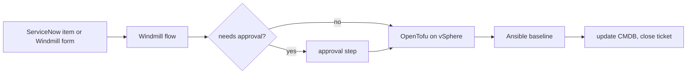

import DocCard from '@site/src/components/DocCard';

# VMware Aria Automation alternatives, by what each one replaces

VMware's own [datasheet](https://vmware.com/docs/vmw-vrealize-automation-datasheet) describes VCF Automation, the product that used to be vRealize and then Aria Automation, as a self-service catalog, blueprints and infrastructure as code, governance policies, orchestration and extensibility, and cost visibility, all in one box.
Most teams pricing a replacement look for one product that does all five.
There isn't a good one, and the teams that move fastest stop looking for it.

{/* truncate */}

This post splits vRA into the jobs it does and names the tool that does each job well, with what it costs as published on the vendor's site.
We make Windmill, which covers some of these jobs and not others, so read it as a partisan post that tries to be precise about where we stop.
It follows [Size your vRO migration before you price it](/blog/size-your-vro-migration), which covers the other half of the estimate: how much of your vRO content you actually have to move.

## Five jobs in one license

Read the datasheet with a migration in mind and vRA comes apart into five jobs:

1. Provisioning: blueprints that describe machines, networks and Kubernetes resources, written in a visual editor or YAML.
2. Configuration: what happens inside the machine after it boots, usually handed to a tool such as Ansible.
3. Self-service and approvals: the catalog a requester picks from, its forms, and the policies that send a request to an approver.
4. Orchestration: vRO workflows, now called VCF Operations orchestrator, and the event broker subscriptions that run them when something happens.
5. Governance and cost: projects, quotas, placement policies, and cost estimates pulled from VCF Operations.

The datasheet lists Terraform and Ansible as integrations, and in many estates vRA was already calling them for the first two jobs.
Those tools don't have to change.
The jobs that leave with vRA are the third, fourth and fifth.

## The short version

| Tool | Jobs it covers | What it leaves to something else | Public pricing |
| --- | --- | --- | --- |
| VCF Automation (for reference) | All five, on VMware Cloud Foundation | Nothing, if you stay on VCF | No. Sold only as a component of VCF, through Broadcom or a reseller ([datasheet](https://vmware.com/docs/vmw-vrealize-automation-datasheet)) |
| Terraform or OpenTofu CLI | Provisioning | Catalog, approvals, schedules, events, cost | No license fee for the CLIs |
| HCP Terraform | Provisioning, policy as code and a no-code catalog (Standard and Premium) | Anything that isn't a Terraform run, events, Day 2 jobs | Yes, per managed resource per month: Essentials $0.10, Standard $0.47, Premium $0.99, free up to 500 resources. Terraform Enterprise is contact sales ([pricing](https://www.hashicorp.com/en/pricing)) |
| Red Hat Ansible Automation Platform | Configuration, workflows with approval nodes, self-service portal, event-driven runs | Provisioning state, cost | No. Quote from Red Hat or a partner ([pricing](https://www.redhat.com/en/technologies/management/ansible/pricing)) |
| HPE Morpheus Enterprise | Catalog, multi-cloud provisioning, orchestration of Terraform, OpenTofu and Ansible, cost analytics | Little, it's the closest one-for-one swap | Partly. One AWS Marketplace contract is listed ($198,500 for 12 months, 1,000 workload entitlements, managed), other terms by private offer ([listing](https://aws.amazon.com/marketplace/pp/prodview-os5i3cv3pchlu)) |
| ServiceNow Service Catalog | Request forms, approvals, CMDB | The work itself, and REST calls to other systems need Integration Hub | No. Packages are sold by custom quote ([pricing](https://www.servicenow.com/products/itsm/pricing.html)) |
| AWS Service Catalog | Catalog and launch constraints for AWS, with CloudFormation and Terraform products | Anything on-premises | Yes, per API call, with 1,000 free calls per account, region and month ([pricing](https://aws.amazon.com/servicecatalog/pricing/)) |
| Windmill | Orchestration, forms, approvals, schedules and event triggers, running Terraform, OpenTofu and Ansible as steps | Provisioning state, deployment inventory, cost management | Yes. Community Edition is free to self-host. Self-hosted Enterprise is $20 per seat per month plus $50 per month for each standard 2 GB worker, with a calculator ([pricing](/pricing)) |

Prices as published on each vendor's site, checked on 2026-11-01.
HPE's own product pages didn't load for us, so the Morpheus figure comes from Morpheus Data's AWS Marketplace listing.

## Provisioning: Terraform or OpenTofu

If your blueprints already call Terraform, or you can rewrite them as modules, this job is solved and has been for years.
The [vSphere provider](https://registry.terraform.io/providers/vmware/vsphere/latest/docs) manages virtual machines on vCenter, and the same module style covers the public clouds you also run.
[OpenTofu](https://opentofu.org/) is the open source fork, under the Linux Foundation.

The CLI alone isn't a vRA replacement, though.
It has no catalog, no approvals and nothing that runs on a schedule or an alert.
[HCP Terraform](https://developer.hashicorp.com/terraform/cloud-docs/overview) adds some of that: [no-code provisioning](https://developer.hashicorp.com/terraform/cloud-docs/workspaces/no-code-provisioning/provisioning) lets someone deploy a module from a form without writing configuration, and Sentinel or OPA policies gate the plan.
Both are on the Standard and Premium tiers.
It's also one of the few rows in the table with a per-unit price list, which makes it easy to model.
What it won't do is run the steps around the Terraform run: the IPAM lookup before, the ticket update after, the patch window next month.

## Configuration: Ansible Automation Platform

If your estate is mostly Ansible, [Red Hat Ansible Automation Platform](https://www.redhat.com/en/technologies/management/ansible) is a strong replacement for more than configuration.
Automation controller chains job templates into workflows, and a workflow can [pause on an approval node](https://docs.redhat.com/en/documentation/red_hat_ansible_automation_platform/2.5/html/using_automation_execution/assembly-ug-overview) until someone approves or denies the next step.
The [self-service automation portal](https://www.redhat.com/en/technologies/management/ansible/self-service-automation), built on Red Hat Developer Hub and Backstage, turns job templates into forms that people without Ansible skills can run.
Event-Driven Ansible runs playbooks from events.

The catch is the same as Terraform's in reverse.
Everything is shaped like a playbook, so provisioning goes through Terraform anyway, and logic that isn't host configuration (calling an API, branching on a CMDB lookup) ends up as a module or a shell task.
Red Hat doesn't publish list prices.
For a side-by-side with Windmill, see [Windmill vs Ansible Automation Platform](/compare/ansible-automation-platform).

## The closest swap: HPE Morpheus Enterprise

If what you want is another cloud management platform, with a catalog, multi-cloud provisioning, policies and cost reports in one product, Morpheus is the category match.
Its [AWS Marketplace listing](https://aws.amazon.com/marketplace/pp/prodview-os5i3cv3pchlu) describes provisioning of VMs, containers and multi-tier apps from a central catalog, orchestration of Terraform, OpenTofu, CloudFormation, Pulumi and Ansible, and cost analytics with right-sizing and budget policies, across hypervisors, public clouds and Kubernetes.

Windmill isn't that.
We have no deployment inventory, no cost reports and no showback, and if those are why you bought vRA, Morpheus or staying on VCF is the honest answer.

## The catalog you may already own: ServiceNow

Many vRA catalogs were never the front door.
Requests started in ServiceNow, and vRA did the work.
If that's your setup, the catalog and the approvals can stay where they are: a catalog item with a Workflow Studio flow and an [Ask for Approval step](https://www.servicenow.com/docs/r/zurich/build-workflows/workflow-studio/ask-approval-action-designer.html) already covers job three.

ServiceNow doesn't do the work, though.
Something still has to clone the VM, run the playbook and close the ticket, and calling that something from a flow with a [REST step requires Integration Hub](https://www.servicenow.com/docs/r/oZRGKGLbfcn968v3Ubchmw/w0neoT8sD9dV2GkROAtiqg), a separate subscription.
A business rule can also call a webhook directly.

## Leaving on-prem: the cloud's own catalog

Some teams use the renewal to leave vSphere for a public cloud.
VCF Automation is moving the other way: in 9.1.1 its native AWS, Azure and GCP endpoints are deprecated and disabled by default, and VMware says the feature [will be discontinued in a future release](https://knowledge.broadcom.com/external/article/448993).

On AWS, [Service Catalog](https://aws.amazon.com/servicecatalog/features/) gives you portfolios of CloudFormation and Terraform products with launch constraints, priced per API call.
It covers the catalog for that one cloud.
It doesn't cover anything left in the data center, and Terraform products don't yet support template constraints or service actions.

## Orchestration: where Windmill fits

The job nobody else in this list takes over cleanly is vRO: the workflows, the scheduled runs and the event subscriptions that glue provisioning, configuration and the ticket together.
That's what [Windmill](/) does.

A Windmill [flow](/docs/flows/flow_editor) is a sequence of scripts in TypeScript, Python, PowerShell, Bash or [Ansible](/docs/getting_started/scripts_quickstart/ansible).
Terraform and OpenTofu run as the CLI from a script on a worker where the binary is [installed](/docs/advanced/preinstall_binaries), with state in your own backend, so Windmill sits on top of the tools in the previous sections instead of replacing them.

The parts that map to vRA:

- Self-service: every script and flow gets a [generated form](/docs/core_concepts/auto_generated_uis) from its inputs, and you can build an [app](/docs/apps/app_editor) on top when a form isn't enough.
- Approvals: an [approval step](/docs/flows/flow_approval) suspends the flow until the approvers resume it. Adding a form to the approval page is an [Enterprise Edition](/pricing) feature.
- Schedules and events: [schedules](/docs/core_concepts/scheduling) and [webhooks](/docs/core_concepts/webhooks) are in every edition, so a ServiceNow business rule or an Alertmanager alert can start a flow. Kafka, NATS and SQS [triggers](/docs/triggers) are self-hosted Enterprise.
- Network reach: workers run where vCenter is reachable. [Agent workers](/docs/core_concepts/agent_workers), which connect out over HTTP from isolated segments, are Enterprise.

What it leaves out is the list from the Morpheus section: no record of deployed machines (that lives in Terraform state, a CMDB or NetBox), no cost reports, no blueprint canvas.
The flows themselves are files in Git, and the core is open source under [AGPLv3](https://github.com/windmill-labs/windmill), so the workflows you move out of vRO don't move into another closed format.

## Three combinations that work

- One platform, cost reports included: Morpheus, or stay on VCF and negotiate. Port the vRO workflows only if the new platform can't run them.
- An Ansible shop: Ansible Automation Platform for configuration, the portal and approvals, Terraform for provisioning. It gets awkward where the logic isn't a playbook.
- Code you own: Terraform or OpenTofu for provisioning, Ansible for configuration, ServiceNow or Windmill forms for intake, and Windmill for the workflows, schedules and events vRO ran. This is the combination our [vRA replacement guide](/use-cases/vmware-vra-replacement) walks through.

Whichever you pick, the timeline is set by the renewal date, not the migration.
Run the [inventory](/blog/size-your-vro-migration) on your vRO export first, so the number you multiply by is the workflows you actually have to move.

	<DocCard
		title="vRA and vRO replacement guide"
		description="How vRO objects map to Windmill, what moves and what stays, and which features need Enterprise."
		href="/use-cases/vmware-vra-replacement"
	/>
	<DocCard
		title="Infrastructure automation"
		description="Terraform, Ansible, approvals, ServiceNow and Day 2 jobs on one open source platform."
		href="/use-cases/infra-automation"
	/>
	<DocCard
		title="Approval steps"
		description="Suspend a flow until approvers resume it from the run page or a resume link."
		href="/docs/flows/flow_approval"
	/>
	<DocCard
		title="Pricing"
		description="Published per-seat and per-worker prices, with a calculator for your setup."
		href="/pricing"
	/>

