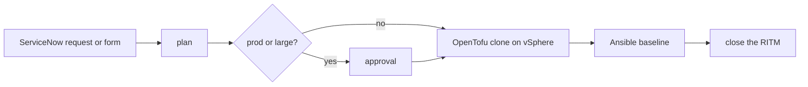

# Size your vRO migration before you price it

We ran our vRO inventory script on VMware's own [Avi Load Balancer plugin for vRealize Orchestrator](https://github.com/vmware/vrealize-orchestrator-plugin-for-alb): 25 workflows, 56 actions.
Three of the workflows were copies of others, one was a single line of script, and 21 of the actions weren't called by anything else in the package.
Before you price a vRO migration, find out how much of it you actually have to migrate.

{/* truncate */}

The script is open source, runs on your machine with plain Python, and reads the export you can already pull from vRO.
It lives in the [windmill-vmware-vra-replacement](https://github.com/windmill-labs/windmill-vmware-vra-replacement) repository, next to a vRA catalog item rebuilt as a [Windmill](/) flow.

## Why the workflow count lies

The number on the vRO dashboard counts everything that was ever saved.
That includes the copy someone made years ago to test a new cluster, the five workflows that differ only by a hard-coded port group, and the one that wraps a single action so it shows up in a menu.

Each workflow and action belongs in one of five buckets, and only two of them are real work:

- Retire: no run in the past year, or an action nothing calls. It doesn't move.
- Merge: same steps and logic as another workflow, give or take a literal. Several become one flow with an input.
- Wrapper: one meaningful step. It becomes one script, or disappears into the flow that calls it.
- Rebuild: built on plugin objects such as `VC:VirtualMachine`. It's rewritten on the vSphere API or another SDK.
- Convert: plain logic. It ports to a script or a flow with few changes.

Price the rebuilds and conversions.
The rest is cleanup you'd want to do anyway.

## Run the inventory on your export

Export your packages from the vRO client, or pull them with [Build Tools for VMware Aria](https://github.com/vmware/build-tools-for-vmware-aria).
Use a read-only account on a non-production instance.
Then point the script at the files:

```bash
git clone https://github.com/windmill-labs/windmill-vmware-vra-replacement
cd windmill-vmware-vra-replacement
python3 tools/vro_inventory.py ~/exports/*.package --out inventory.md --json inventory.json
```

It reads `.package` files, extracted packages and Build Tools projects, and nothing leaves the machine.
Here is the summary it printed for the Avi plugin:

| Verdict | Workflows | Actions | Becomes |
| --- | --- | --- | --- |
| retire | 0 | 21 | Do not migrate |
| merge | 3 | 0 | One flow with an input for what differs |
| wrapper | 1 | 0 | One Windmill script, or call the tool directly |
| rebuild | 20 | 34 | Script on the vSphere API / SDK |
| convert | 1 | 1 | TypeScript, Python or PowerShell script |

Two caveats on that run.
The Avi package is a library, so its actions exist to be called by other people's workflows, and "not referenced in this export" is expected there.
In your own estate, the same list is a set of candidates to check, not a verdict.
And a plugin is close to the worst case for rebuilds: nearly everything in it talks to the Avi controller through plugin objects.

The report also lists every plugin type your content depends on, with a count.
That table is your integration backlog: each plugin is replaced once, as a shared module, and every script that needed it imports it.

The retire bucket needs one more input.
Give the script a CSV of last run dates, which you can build from the vRO REST API, and it marks the workflows nobody ran in a year:

```bash
python3 tools/vro_inventory.py ~/exports/ --runs runs.csv --since-days 365
```

## What convert and rebuild look like

Most actions are a few lines of JavaScript around a plugin call.
This one finds powered-off VMs by name prefix:

```javascript
var vms = VcPlugin.getAllVirtualMachines(null,
  "xpath:name[starts-with(.,'" + prefix + "')]");
var result = [];
for (var i in vms) {
  if (vms[i].runtime.powerState.value == "poweredOff") result.push(vms[i]);
}
System.log("Found " + result.length + " powered-off VMs");
return result;
```

In Windmill it's a TypeScript script.
The loop survives.
The plugin object becomes a call to the vSphere Automation REST API, and the configuration element becomes a `vmware_vsphere` resource that the generated form lets you pick:

```typescript
type VmwareVsphere = { server: string; username: string; password: string };

export async function main(vsphere: VmwareVsphere, prefix = "") {
  const base = `https://${vsphere.server}/api`;
  const token = await (await fetch(`${base}/session`, {
    method: "POST",
    headers: { Authorization: "Basic " + btoa(`${vsphere.username}:${vsphere.password}`) },
  })).json();
  const vms = await (await fetch(`${base}/vcenter/vm?power_states=POWERED_OFF`, {
    headers: { "vmware-api-session-id": token },
  })).json();
  return vms.filter((vm) => vm.name.startsWith(prefix));
}
```

If your team already writes PowerCLI, keep writing it.
PowerShell is a script language in Windmill like any other, and `Import-Module VMware.VimAutomation.Core` installs PowerCLI from the PowerShell Gallery on the first run.
Both versions are in the [repository](https://github.com/windmill-labs/windmill-vmware-vra-replacement/tree/main/f/infra).

Coding agents are good at this kind of translation, because the target is ordinary code.
The [Windmill CLI](/docs/advanced/cli) installs skills that teach Claude Code and other agents how Windmill scripts are written, so an agent can take an exported action and draft the script for a person to review.

## What stays where it is

Moving off vRO doesn't mean moving off vSphere.
The hypervisor, your Terraform or OpenTofu modules, your Ansible roles and ServiceNow all stay, and the new workflows call them.

The example repository shows what that looks like for a typical "Linux VM" catalog item.
One flow plans the size, asks for approval when the request is for production, clones the template with OpenTofu, applies an Ansible baseline over SSH and closes the ServiceNow request.
If a step fails after the VM exists, the failure handler destroys it and writes the error on the ticket.
The form Windmill generates from the flow's inputs is the catalog item, or ServiceNow stays the front door and calls the flow through a webhook.



Every flow in the repository has a `dry_run` input, so you can walk it end to end before it touches vCenter.

## A plan that ends at the renewal date

VCF Automation is [sold only as part of VMware Cloud Foundation](https://vmware.com/docs/vmw-vrealize-automation-datasheet), so the savings start at the license renewal, not at cutover.
Work backward from the renewal notice deadline:

1. Export your vRO content and run the inventory, to get a range instead of a guess.
2. Self-host Windmill, push the example repository, and run its flows in dry run.
3. Rebuild two or three of your own workflows end to end, including one triggered by an event, and time them.
4. Multiply by the rebuild and convert counts, and decide what must be off vRO before the deadline and what can wait a cycle.

If the inventory misreads something in your export, [open an issue](https://github.com/windmill-labs/windmill-vmware-vra-replacement/issues) with a redacted sample.
We tested it on VMware's public plugin and on synthetic packages, and your vRO version may have element types we haven't seen.

For the full mapping of vRO objects to Windmill, with which features need Enterprise, read the [open source alternative to VMware vRA and vRO](/use-cases/vmware-vra-replacement) guide.
For everything else infrastructure teams run on Windmill, from rolling patches to certificate checks, see [infrastructure automation](/use-cases/infra-automation).
