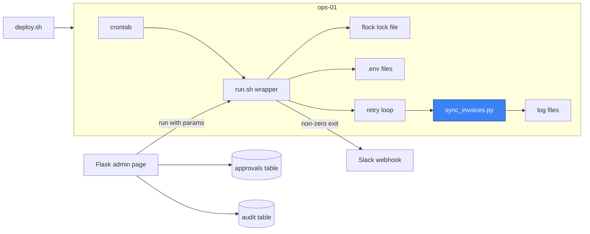

import DocCard from '@site/src/components/DocCard';

# The internal scheduler you'll end up building

It starts as one line in a crontab on a box everyone calls `ops-01`.
Then the API it calls times out on a Sunday, so someone wraps it in a retry loop.
Then a slow run overlaps the next one and sends every invoice twice, so someone adds a lock file.
Each of those took an afternoon, and none of them was a bad call.
Two years later the team owns a scheduler, a secrets convention, a log search, an alerting path and an admin UI, and nobody remembers deciding to build any of them.

This post is for engineering leads looking at that setup and deciding whether to keep building it.
It lists the pieces in the order teams usually add them, maps each one to what [Windmill](/) ships, gives you a way to price your own version with your own numbers, and says when building is still the right call.
We build Windmill, so we're not neutral, which is why every row links to the docs page that backs it.

{/* truncate */}

## Same pieces, same order

The order is predictable because each piece is the answer to a specific bad day.
Nobody adds an audit table before the first security review asks for one, and nobody builds an approval column before the first run that should have needed a sign-off.

After a couple of years, the setup tends to look like this:



One box in that diagram is the business logic.
Everything else is infrastructure the team wrote to run it, and each piece has its own failure mode: the lock file left behind by a killed process, the `.env` that drifted between hosts, the admin page that runs as root.

## The weekend estimate is real now

For years, "I could build it in a weekend" was a joke.
With a coding agent it isn't.
Hand it the table below and by Sunday night you'll have a scheduler, a retry wrapper, a lock, an admin page and the tests that say they work.

What the agent can't write is the list of failures that only show up after years of other people's jobs running on the thing.
It knows what's in the prompt, and nobody puts these in the prompt until they've been paged for them.
A few that Windmill handles because production taught us to:

- A worker dies in the middle of a job, and the job looks like it's running forever.
  Windmill's servers check every 10 seconds for jobs whose worker stopped sending pings, restart them in place up to three times, then fail them, raising a [critical alert](/docs/core_concepts/critical_alerts) on Enterprise Edition.
- A run takes longer than its interval.
  The schedule keeps one occurrence queued and [skips the ones that fell due in the meantime](/docs/core_concepts/scheduling#skipped-occurrences), with a warning, instead of piling up runs that all hit the same API at once.
- A script that worked yesterday fails today because a dependency shipped a new release overnight.
  Every script runs against its own pinned lockfile, and for Python and Bun an instance setting can refuse packages published in the last few days.

None of these is hard to code once you know about it.
The expensive part is finding out, and the usual way to find out is an incident.
A weekend of generated code also comes with years of owning it: someone on your team still debugs it at 3am, and that person didn't write it.

## What each piece maps to

The table is in the order teams usually hit them.
The last column says where a capability sits on the [pricing page](/pricing), since several of the later rows are [Enterprise Edition](/pricing) features and you should know that before you count them.

| What you build | What usually prompts it | Windmill equivalent | Edition |
| --- | --- | --- | --- |
| A crontab entry | A script needs to run every night | [Schedules](/docs/core_concepts/scheduling) on any script or flow, with cron syntax and a timezone | All |
| A retry loop in a wrapper | A flaky API fails at 3am | [Retries](/docs/flows/retries) with constant or exponential backoff on flow steps, and on a schedule that runs a single script | Flow steps: all. Schedules: Enterprise |
| A lock file so it doesn't run twice | A slow run overlaps the next one | A schedule keeps one occurrence queued, scheduled scripts never overlap, and flows have a "no overlap" toggle ([skipped occurrences](/docs/core_concepts/scheduling#skipped-occurrences)). [Concurrency limits](/docs/core_concepts/concurrency_limits) cap runs per key across every trigger | Overlap: all. Concurrency limits: Enterprise and Cloud |
| `.env` files on the host | A second script needs the same API key | [Variables and secrets](/docs/core_concepts/variables_and_secrets), encrypted per workspace, and [resources](/docs/core_concepts/resources_and_types) for typed connections | All. External secret managers: Enterprise |
| `grep` over log files | Someone asks whether it ran last Tuesday | The [runs page](/docs/core_concepts/monitor_past_and_future_runs): every job's arguments, logs and result, filterable by path, user, trigger and status | All. Retention is capped at 30 days on self-hosted Community Edition |
| A Slack webhook on non-zero exit | A failure goes unnoticed for a week | [Error handlers](/docs/core_concepts/error_handling) as a flow step, a workspace-wide script, or per schedule | Flow step and custom workspace handler: all. Built-in Slack and Teams handlers: Enterprise and Cloud. Schedule handlers: Enterprise |
| CLI flags, then a form to run it by hand | Support needs to rerun it for one customer | An [auto-generated UI](/docs/core_concepts/auto_generated_uis) from the `main` function's parameters | All |
| An approval column in a database table | A run needs a manager's sign-off | [Approval steps](/docs/flows/flow_approval) that suspend a flow until someone approves it | Steps: all. Approval forms and logged-in approvers: Enterprise and Cloud |
| An internal admin page | Ops wants buttons instead of a terminal | [Apps](/docs/apps/app_editor) built on the same scripts | All |
| A `deploy.sh` | Someone edits the script directly on the box | [Git sync](/docs/advanced/git_sync) and the [CLI](/docs/advanced/cli) (`wmill sync push`) | CLI: all. Git sync: Enterprise and Cloud, and Community Edition workspaces with up to 2 users |
| An audit table | Security asks who changed what | [Audit logs](/docs/core_concepts/audit_logs) for every operation with side effects | Full logs: Enterprise and paid Cloud plans. Redacted otherwise |

Most of the top half of the table is in the open source Community Edition.
The rows that matter once several teams share the setup (concurrency keys, schedule alerting, a full audit trail) lean Enterprise.
If those are the rows you need, the license goes into the sizing below like any other cost.

## The code stays code

The usual objection to adopting a platform is losing the code: the scripts end up as boxes in a UI, outside review and outside git.
In Windmill, a script is a file with a `main` function.

```python
import wmill
import requests


def main(customer_id: str, since: int, dry_run: bool = True):
    # since is a Unix timestamp
    # Replaces the STRIPE_API_KEY line in .env
    api_key = wmill.get_variable("f/billing/stripe_api_key")
    invoices = requests.get(
        "https://api.stripe.com/v1/invoices",
        params={"customer": customer_id, "created[gte]": since},
        auth=(api_key, ""),
        timeout=30,
    ).json()["data"]
    if not dry_run:
        ...  # write them to your database
    return {"count": len(invoices)}
```

The parameters of `main` become the schedule's arguments, the form support uses to rerun it for one customer, and the payload of its [webhook](/docs/core_concepts/webhooks).
The argparse block and the wrapper go away; the logic doesn't change.

[`wmill sync pull`](/docs/advanced/cli/sync) puts it in your repository as three files:

```
f/billing/
  sync_invoices.py           # the code above
  sync_invoices.script.yaml  # summary, schema of main, settings
  sync_invoices.script.lock  # pinned dependencies
```

Pull requests, review and CI work on those files the way they work on the rest of your code, and you can still [run the script locally](/docs/advanced/local_development/run_locally).
TypeScript and Bash work the same way, along with the other [supported languages](/docs/getting_started/scripts_quickstart).

## Size it with your own numbers

We won't give you a cost figure, because it depends on inputs only you have.
Here's how to collect them in an afternoon.

Start with the table above and mark each row as built, needed next, or not needed.
Then fill in the inputs:

| Input | Where to find it |
| --- | --- |
| Time spent on the tooling in the last 12 months | Commits and tickets touching the wrapper, admin page and deploy script, then ask their authors how long those took |
| Time to build the rows marked "needed next" | Your own estimate, per row |
| On-call load caused by the tooling | Alerts where the script was fine and the runner wasn't: stale lock, full disk, dead host, expired credential |
| One-off incidents | Postmortems for double runs, silent failures, missed runs and leaked secrets, with the hours spent and what each cost the business |
| Loaded cost of an engineer hour | Finance |

For the first row, git gives you a starting point:

```bash
git log --since="12 months ago" --format='%an %ad' --date=short -- ops/cron ops/admin deploy.sh
```

Commits aren't hours, but the list tells you who to ask.
It also tells you the bus factor: if one name covers most of the lines, the cost of that person leaving belongs in the estimate.

The cost of building for the next year is then roughly:

```
build = (maintenance hours + hours for the "needed next" rows + tooling on-call hours) × hourly cost
      + sum over incidents of (hours spent × hourly cost + business impact)
```

And the cost of adopting:

```
adopt = migration hours × hourly cost
      + hours to run the platform × hourly cost   (zero on Cloud; Postgres, upgrades and workers when self-hosted)
      + license, if you need the Enterprise rows
```

Don't estimate migration hours from the script count alone.
Migrate two scripts, one clean and one ugly, and time both.
The clean one tells you the floor, and the ugly one tells you how much of your logic lives in the wrapper rather than in the script.

The incident line is the one teams leave out, because it doesn't recur on a schedule.
A single double charge or a week of silently failed syncs can outweigh a year of maintenance hours, so put the ones you've already had on the list, with their real cost.
A coding agent shrinks the build hours in that formula.
It doesn't shrink the incident line, because that line is the experience you haven't had yet.

## When building is the right call

Sometimes the numbers come out in favor of building, and in a few cases they don't need to be run at all.

Orchestration is the product.
If you sell a job runner, or your scheduling logic is what differentiates you, owning it is the point.
A platform underneath would put someone else's roadmap on your critical path.

You have constraints no platform meets.
A latency budget in microseconds, hardware a general-purpose worker can't run on, or a rule that forbids adding another service with its own database are all real, and no table of features fixes them.

A team is already staffed to own it.
If a platform team exists to run this, its cost is already paid, and the table above is that team's roadmap.
The question then isn't build or buy, it's whether those engineers spend next year on rows six through eleven or on something only your company needs.

You're still on row two.
Five cron jobs that nobody runs by hand, with a retry loop and no audit requirement, don't need a platform.
Revisit when the admin page shows up in a sprint plan.

## Where that leaves you

If your setup has reached the admin page or the approval column, you've built most of a scheduler already, and the rest of the table is coming.
At that point, adopting one is mostly a migration of the wrapper, not of the scripts, and the inputs above tell you whether it pays off.
If orchestration is your product, or you're five cron jobs in, keep building.

The [scheduled tasks](/use-cases/scheduled-tasks) and [internal tools](/use-cases/internal-tools) pages cover the two halves of the table in more depth.

<div className="grid grid-cols-2 gap-6 mb-4">
	<DocCard
		title="Schedules"
		description="Run scripts and flows on a cron, with retries, overlap control and error handlers."
		href="/docs/core_concepts/scheduling"
	/>
	<DocCard
		title="Error handling"
		description="Flow error handlers, workspace error handlers and schedule error handlers."
		href="/docs/core_concepts/error_handling"
	/>
	<DocCard
		title="Git sync"
		description="Keep every script, flow and app in a git repository and deploy from it."
		href="/docs/advanced/git_sync"
	/>
	<DocCard
		title="Auto-generated UIs"
		description="Turn the parameters of a script into a form anyone can run."
		href="/docs/core_concepts/auto_generated_uis"
	/>
</div>
