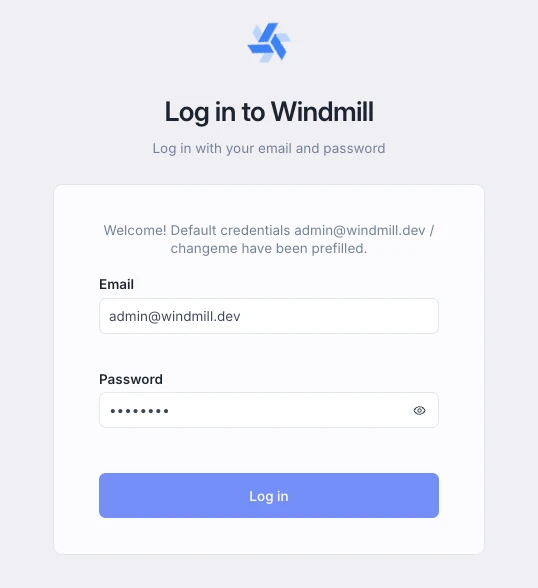
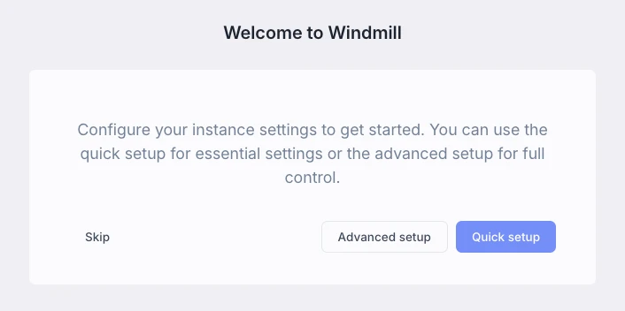
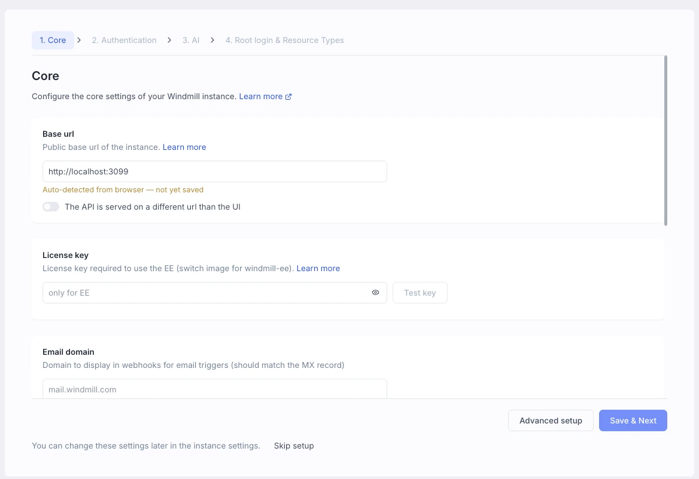
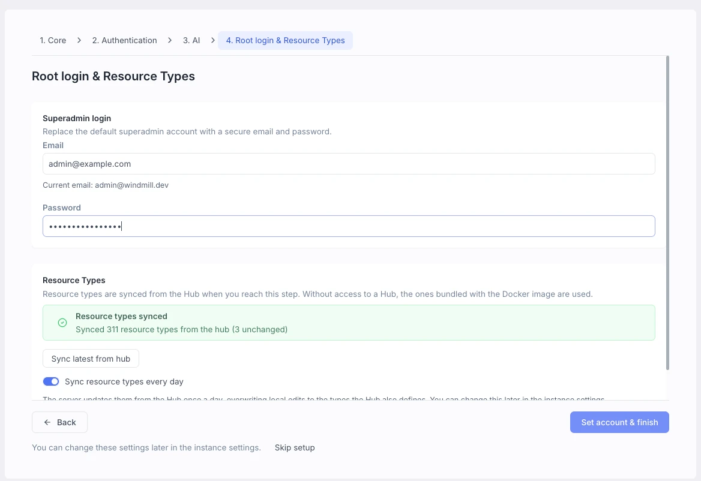
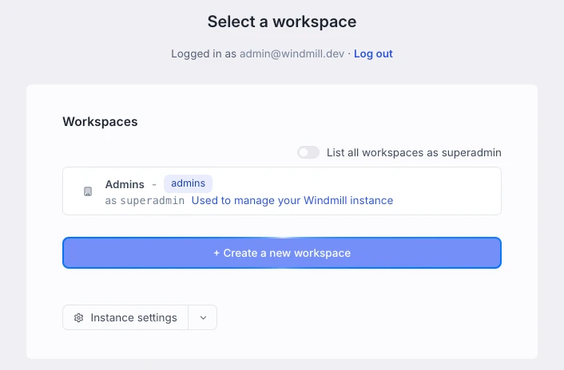

import DocCard from '@site/src/components/DocCard';

# Self-host Windmill

Self-host Windmill on your own infrastructure.

For small setups, use [Docker](#docker) and Docker Compose on a single instance.
For larger and production use-cases, use our [Helm chart](#helm-chart) to deploy on Kubernetes.
You can also run [Windmill workers on Windows](../../misc/17_windows_workers/index.mdx) without Docker.


> Example of a self-hosted Windmill instance on [localhost](#docker).

<br />

## Architecture

Windmill itself just requires 3 components:

- A Postgres database, which contains the entire state of Windmill, including the job queue.
- The Windmill container running in server mode (and replicated for high availability). It serves both the frontend and the API. It needs to connect to the database and is what is exposed publicly to serve the frontend. It does not need to communicate to the workers directly.
- The Windmill container running in worker mode (and replicated to handle more job throughput). It needs to connect to the database and does not communicate to the servers. See [Workers and worker groups](../../core_concepts/9_worker_groups/index.mdx) for how jobs are assigned to workers.

There are 3 optional components:

- Windmill LSP to provide intellisense on the [Monaco web Editor](../../code_editor/index.mdx).
- Windmill [Multiplayer](../../core_concepts/7_multiplayer/index.md) ([Cloud & Enterprise Selfhosted only](/pricing)) to provide real time collaboration.
- A reverse proxy (caddy in our [Docker compose](#docker)) to the Windmill server, LSP and multiplayer in order to expose a single port to the outside world.

The docker-compose file [below](#docker) uses all six components, and we recommend handling TLS termination outside of the provided Caddy service.


## Cloud provider-specific guides

For instances with specific cloud providers requirements:

- [AWS, GCP, Azure](#aws-gcp-azure-neon)
- [Ubicloud](#ubicloud)
- [Fly.io](#flyio)
- [Hetzner, Fargate, Digital Ocean, Linode, Scaleway, Vultr, OVH, ...](#hetzner-fargate-digital-ocean-linode-scaleway-vultr-ovh-)

If you have no specific requirements, see [Docker](#docker).

### AWS, GCP, Azure, Neon

We recommend using the [Helm chart](#helm-chart) to deploy on managed [Kubernetes](https://kubernetes.io/). But for simplified setup, simply use the docker-compose (see [below](#docker)) on a single large instance and use a high number of replicas for the worker service.

The rule of thumb is 1 worker per 1vCPU and 1-2 GB of RAM. Cloud providers have managed load balancer services (ELB, GCLB, ALB) and managed database (RDS, Cloud SQL, Aurora, Postgres on Azure). We recommend disabling the db service in docker-compose and using an external database by setting the `DATABASE_URL` in the [.env][windmill-env] file for handling [environment variables](../../core_concepts/47_environment_variables/index.mdx).

Windmill is compatible with [AWS Aurora](https://aws.amazon.com/rds/aurora/), [GCP Cloud SQL](https://cloud.google.com/sql), [Azure](https://azure.microsoft.com/en-us) and [Neon](https://neon.tech/) serverless database.

Use the managed load balancer to point to your instance on the port you have chosen to expose in the caddy section of the docker-compose (by default 80). We recommend doing TLS termination and associating your domain on your managed load balancer. Once the domain name is chosen, set the [Base URL](../18_instance_settings/index.mdx#base-url) in the instance settings accordingly. That is it for a minimal setup. Read about [Worker groups](../../core_concepts/9_worker_groups/index.mdx) to configure more finely your workers on more nodes and with different resources. Once done, be sure to setup [SSO login](../../advanced/27_setup_oauth/index.mdx) with Azure AD, Google Workspace or GitHub if relevant.

:::tip AWS ECS

To be able to use the AWS APIs within Windmill on ECS containers, just whitelist the following environment variables in .env:
`WHITELIST_ENVS = "AWS_EXECUTION_ENV,AWS_CONTAINER_CREDENTIALS_RELATIVE_URI,AWS_DEFAULT_REGION,AWS_REGION"`
:::

<div className="grid grid-cols-2 gap-6 mb-4">
	<DocCard
		title="Workers and worker groups"
		description="Worker Groups allow users to run scripts and flows on different machines with varying specifications."
		href="/docs/core_concepts/worker_groups"
	/>
	<DocCard
		title="Windmill on AWS EKS or ECS"
		description="Windmill can also be deployed on AWS EKS or ECS"
		href="/docs/advanced/self_host/aws_eks_ecs"
	/>
	<DocCard
		title="Windmill on Azure"
		description="Deploy Windmill on Azure AKS with optional Entra ID database auth."
		href="/docs/advanced/self_host/azure_entra_id"
	/>
	<DocCard
		title="Windmill for Microsoft environments"
		description="Azure, Windows, SQL Server, Entra ID and Teams: where each capability is documented and the edition it needs."
		href="/docs/advanced/self_host/microsoft_environments"
	/>
</div>

### Ubicloud

Ubicloud provides cost-efficient managed Kubernetes and Postgresql. They are a great compromise if you are cost sensitive but still want to get a multi-node Kubernetes Windmill setup. And they are open-source too as an infra layer on top of other cloud providers.

<div className="grid grid-cols-2 gap-6 mb-4">
	<DocCard
		title="Ubicloud"
		description="Ubicloud Community-Contributed Guide."
		href="https://www.ubicloud.com/docs/managed-kubernetes/windmill-tutorial"
		target="_blank"
	/>
</div>

### Fly.io

<div className="grid grid-cols-2 gap-6 mb-4">
	<DocCard
		title="Fly.io"
		description="Fly.io Community-Contributed Guide."
		href="https://dev.to/singee/deploy-windmill-on-flyio-3ii3"
		target="_blank"
	/>
</div>

### Render.com
<div className="grid grid-cols-2 gap-6 mb-4">
	<DocCard
		title="Render.com"
		description="Render.com Setup Guide."
		href="https://github.com/alpetric/wmilll_render"
		target="_blank"
	/>
</div>

### Hetzner, Fargate, Digital Ocean, Linode, Scaleway, Vultr, OVH, ...

Windmill works with those providers using the [Docker containers](#docker) and specific guides are in progress.

## Docker

### Setup Windmill on localhost

Self-host Windmill in less than a minute:

<iframe
	style={{ aspectRatio: '16/9' }}
	src="https://www.youtube.com/embed/NQP2A8RGyoo"
	title="YouTube video player"
	frameBorder="0"
	allow="accelerometer; autoplay; clipboard-write; encrypted-media; gyroscope; picture-in-picture; web-share"
	allowFullScreen
	className="border-2 rounded-lg object-cover w-full dark:border-gray-800"
></iframe>

<br />

Using [Docker](https://www.docker.com/) and [Caddy](https://caddyserver.com/), Windmill can be deployed using 3 files:
([`docker-compose.yml`][windmill-docker-compose], [`Caddyfile`][windmill-caddyfile]) and a [.env][windmill-env] in a single command.

[Caddy][caddy] is the reverse proxy: it sends `/ws/*`, `/ws_mp/*` and `/ws_debug/*` to the `windmill_extra` container (port 3000), which serves the editor's language servers, multiplayer and the debugger, and everything else to Windmill (port 8000).
It also redirects TCP traffic on port 25 to Windmill (port 2525) for [email triggers](../../triggers/1_email_triggers/index.mdx).
Postgres holds the entire state of Windmill, the rest is fully stateless.

Make sure Docker is started:

- Mac: `open /Applications/Docker.app`
- Windows: `start docker`
- Linux: `sudo systemctl start docker`

and type the following commands:

```
curl https://raw.githubusercontent.com/windmill-labs/windmill/main/docker-compose.yml -o docker-compose.yml
curl https://raw.githubusercontent.com/windmill-labs/windmill/main/Caddyfile -o Caddyfile
curl https://raw.githubusercontent.com/windmill-labs/windmill/main/.env -o .env

docker compose up -d
```

Go to [http://localhost](http://localhost) et voilà. Then you can [login for the first time](#first-time-login).

### Use an external database

For more production use-cases, we recommend using the [Helm-chart](#helm-chart). However, the docker-compose on a big instance is sufficient for many use-cases.

To setup an external database, you need to set DATABASE_URL in the .env file to point your external database. You should also set the number of db replicas to 0.

:::tip Managed PostgreSQL / no superuser access

In setups where the Windmill database user is not a PostgreSQL superuser (Scaleway, Azure Database for PostgreSQL, GCP Cloud SQL, AWS RDS/Aurora, etc.), you must create the Windmill roles manually before the first start. Windmill cannot create them itself in this case: the `windmill_admin` role is created `WITH BYPASSRLS`, and only a superuser can create a `BYPASSRLS` role. If you skip this step, the initial migration fails with:

```
role "windmill_admin" does not exist
```

Run the init script with a **privileged role** that is allowed to create roles (your provider's admin role — e.g. `_rdb_superadmin` on Scaleway, the master/`postgres` user on RDS, GCP and Azure):

```bash
curl https://raw.githubusercontent.com/windmill-labs/windmill/main/init-db-as-superuser.sql -o init-db-as-superuser.sql
psql <PRIVILEGED_DATABASE_URL> -f init-db-as-superuser.sql
```

Make sure that the user used in the DATABASE_URL passed to Windmill has the role `windmill_admin` and `windmill_user`:

```sql
GRANT windmill_admin TO <user used in database_url>;
GRANT windmill_user TO <user used in database_url>;
```

Finally, the Windmill roles need `USAGE` on the `public` schema. The simplest way to guarantee this is to let the Windmill database user **own its database** — create the database while connected as that user (`CREATE DATABASE windmill;`) rather than pointing Windmill at a pre-provisioned database owned by another role. If you do use a database owned by another role and the provider has stripped the default `USAGE` grant on `public` (some managed setups, e.g. certain Scaleway databases, do this), the `windmill_admin`/`windmill_user` roles cannot read any table and every query fails with:

```
permission denied for schema public
```

In that case, grant schema usage with the same privileged role:

```sql
GRANT USAGE ON SCHEMA public TO windmill_user, windmill_admin;
```

:::

### Set number of replicas accordingly in docker-compose

In the docker-compose, set the number of windmill_worker and windmill_worker_native replicas to your needs.

### Enterprise Edition

To use the [Enterprise Edition](/pricing), you need pass the license key in the [instance settings](../18_instance_settings/index.mdx#license-key). A same license key can be used for multiple instances (for dev instances make sure to turn on the 'Non-prod instance' flag from the [instance settings](../18_instance_settings/index.mdx#non-prod-instance)).

You can then enable multiplayer by setting `ENABLE_MULTIPLAYER=true` on the `windmill_extra` service in the docker-compose.

You will be provided a license key when you purchase the enterprise edition or start a trial. Start a trial from the [Pricing](/pricing) page or contact us at contact@windmill.dev to get a trial license key. You will benefit from support, SLA and all the [additional features](/pricing) of the enterprise edition.

<iframe
	style={{ aspectRatio: '16/9' }}
	src="https://www.youtube.com/embed/YAoLXwayjT8"
	title="YouTube video player"
	frameBorder="0"
	allow="accelerometer; autoplay; clipboard-write; encrypted-media; gyroscope; picture-in-picture; web-share"
	allowFullScreen
	className="border-2 rounded-lg object-cover w-full dark:border-gray-800"
></iframe>

<br />

More details at:

<div className="grid grid-cols-2 gap-6 mb-4">
	<DocCard
		title="Upgrade to Enterprise Edition"
		description="Docs on how to upgrade to the Enterprise Edition of a Self-Hosted Windmill instance."
		href="/docs/enterprise/plans_details#self-host"
	/>
</div>

### Security considerations

The official Windmill docker-compose runs the default workers with [PID namespace isolation](../27_security_isolation/index.mdx#pid-namespace-isolation), which prevents jobs from reading the worker's memory and environment variables.
They set `privileged: true` and `FAVOR_UNSHARE_PID=true`: jobs run under `unshare` unless the **Job isolation** [instance setting](../18_instance_settings/index.mdx) selects another mode.
The native worker runs without isolation.

For additional security, you can enable NSJAIL sandboxing, which adds filesystem and resource isolation: set the **Job isolation** instance setting to **Nsjail**, or `DISABLE_NSJAIL=false` on the workers.

#### Windows workers

PID namespace isolation is Linux-only. Do not set `ENABLE_UNSHARE_PID` or `FAVOR_UNSHARE_PID` on Windows worker services.

For complete security documentation, see [Security and Process Isolation](/docs/advanced/security_isolation).

### Configuring domain and reverse proxy

To deploy Windmill to the `windmill.example.com` domain, make sure to set "Base Url" correctly in the [Instance settings](../18_instance_settings/index.mdx#base-url).

You can use any reverse proxy as long as it routes like the HTTP part of the provided [Caddyfile][windmill-caddyfile], with WebSocket support on the `/ws*` paths:

```
{$BASE_URL} {
        bind {$ADDRESS:0.0.0.0 ::}

        @extra path /ws/* /ws_mp/* /ws_debug/*
        reverse_proxy @extra http://windmill_extra:3000

        reverse_proxy /* http://windmill_server:8000
}
```

The default docker-compose file exposes the Caddy reverse proxy on port 80, configured by the Caddyfile downloaded above. Configure both the Caddyfile and the docker-compose file to fit your needs. The documentation for Caddy is available [here](https://caddyserver.com/docs/caddyfile).

#### Use provided Caddy to serve https

For simplicity, we recommend using an external reverse proxy such as Cloudfront or Cloudflare and point to your instance on the port you have chosen (by default, :80).

Caddy can also serve HTTPS itself. In both cases below, edit the caddy section of the docker-compose (its commented lines show each option), then run `docker compose up -d` and set the [Base URL](../18_instance_settings/index.mdx#base-url) in the instance settings to the `https://` address.

- **Automatic certificates.** Replace `BASE_URL=":80"` with `BASE_URL=mydomain.com` and uncomment `443:443` in `ports`. Caddy obtains and renews a Let's Encrypt certificate on its own, as long as the domain points at the server and ports 80 and 443 are reachable. Keep port 80 published: Caddy uses it to redirect HTTP to HTTPS and for one of its certificate challenges.
- **Your own certificate files.** Set `BASE_URL=":443"`, uncomment `443:443`, mount a folder holding `cert.pem` and `key.pem` at `/certs` and uncomment the `tls /certs/cert.pem /certs/key.pem` line in the Caddyfile. See Caddy's [tls](https://caddyserver.com/docs/caddyfile/directives/tls) directive for other options.

#### Traefik configuration

<details>
  <summary>Here is a template of a docker-compose to expose Windmill to Traefik. Make sure to replace the `traefik` network with whatever network you have it running on. Code below:</summary>

You may need to adapt this depending on if you have Traefik running or on your configuration. This also assumes you have a `letsencryptresolver` or change the name to your certificate resolver if you want to use the `websecure` entrypoint.

It follows the default [docker-compose.yml][windmill-docker-compose], with Traefik in place of Caddy: `/ws/*`, `/ws_mp/*` and `/ws_debug/*` go to `windmill_extra`, everything else to `windmill_server`. For [email triggers](../../triggers/1_email_triggers/index.mdx), uncomment the `tcp` labels and add an `smtp` entrypoint on port 25 to your Traefik static configuration.

```yaml
x-logging: &default-logging
  driver: 'json-file'
  options:
    max-size: '${LOG_MAX_SIZE:-20m}'
    max-file: '${LOG_MAX_FILE:-10}'
    compress: 'true'

services:
  db:
    deploy:
      # To use an external database, set replicas to 0 and set DATABASE_URL to the external database url in the .env file
      replicas: 1
    image: postgres:18
    shm_size: 1g
    restart: unless-stopped
    volumes:
      # From 18 on, the official image keeps the cluster in a major-version
      # subdirectory, so the mount is the parent directory and not .../data
      - db_data:/var/lib/postgresql
    expose:
      - 5432
    networks:
      - windmill
    environment:
      POSTGRES_PASSWORD: changeme
      POSTGRES_DB: windmill
    healthcheck:
      test: ['CMD-SHELL', 'pg_isready -U postgres']
      interval: 10s
      timeout: 5s
      retries: 5
    logging: *default-logging

  windmill_server:
    image: ${WM_IMAGE}
    pull_policy: always
    deploy:
      replicas: 1
    restart: unless-stopped
    expose:
      - 8000
      - 2525
    environment:
      - DATABASE_URL=${DATABASE_URL}
      - MODE=server
    networks:
      - windmill
      - traefik
    depends_on:
      db:
        condition: service_healthy
    volumes:
      - worker_logs:/tmp/windmill/logs
    labels:
      - traefik.enable=true
      - traefik.docker.network=traefik
      - traefik.http.services.windmill_server.loadbalancer.server.port=8000
      # http
      - traefik.http.routers.windmill_server_http.entrypoints=web
      - traefik.http.routers.windmill_server_http.rule=Host(`windmill.yourdomain.com`)
      - traefik.http.routers.windmill_server_http.service=windmill_server
      # https
      - traefik.http.routers.windmill_server_https.entrypoints=websecure
      - traefik.http.routers.windmill_server_https.rule=Host(`windmill.yourdomain.com`)
      - traefik.http.routers.windmill_server_https.service=windmill_server
      - traefik.http.routers.windmill_server_https.tls=true
      - traefik.http.routers.windmill_server_https.tls.certresolver=letsencryptresolver
      # email triggers (needs an `smtp` entrypoint on :25 in the Traefik static configuration)
      # - traefik.tcp.routers.windmill_smtp.entrypoints=smtp
      # - traefik.tcp.routers.windmill_smtp.rule=HostSNI(`*`)
      # - traefik.tcp.routers.windmill_smtp.service=windmill_smtp
      # - traefik.tcp.services.windmill_smtp.loadbalancer.server.port=2525
    logging: *default-logging

  windmill_worker:
    image: ${WM_IMAGE}
    pull_policy: always
    deploy:
      replicas: 3
      resources:
        limits:
          memory: 2048M
          # for GB, use syntax '2Gi'
    restart: unless-stopped
    # PID namespace isolation for jobs, see https://www.windmill.dev/docs/advanced/security_isolation
    privileged: true
    environment:
      - DATABASE_URL=${DATABASE_URL}
      - MODE=worker
      - WORKER_GROUP=default
      - FAVOR_UNSHARE_PID=true
    networks:
      - windmill
    depends_on:
      db:
        condition: service_healthy
    # to mount the worker folder to debug, KEEP_JOB_DIR=true and mount /tmp/windmill
    volumes:
      - worker_dependency_cache:/tmp/windmill/cache
      - worker_logs:/tmp/windmill/logs
    logging: *default-logging

  ## This worker is specialized for "native" jobs. Native jobs run in-process and thus are much more lightweight than other jobs
  windmill_worker_native:
    # Use ghcr.io/windmill-labs/windmill-ee:main for the ee
    image: ${WM_IMAGE}
    pull_policy: always
    deploy:
      replicas: 1
      resources:
        limits:
          memory: 2048M
    restart: unless-stopped
    environment:
      - DATABASE_URL=${DATABASE_URL}
      - MODE=worker
      - WORKER_GROUP=native
      - NATIVE_MODE=true
      - SLEEP_QUEUE=200
    networks:
      - windmill
    depends_on:
      db:
        condition: service_healthy
    volumes:
      - worker_logs:/tmp/windmill/logs
    logging: *default-logging

  # Language servers, multiplayer (Enterprise Edition) and debugger
  windmill_extra:
    image: ghcr.io/windmill-labs/windmill-extra:latest
    pull_policy: always
    restart: unless-stopped
    expose:
      - 3000
    environment:
      - ENABLE_LSP=true
      - ENABLE_MULTIPLAYER=false # Set to true to enable multiplayer (Enterprise Edition)
      - ENABLE_DEBUGGER=true
      - DEBUGGER_PORT=3003
      - ENABLE_NSJAIL=false
      - REQUIRE_SIGNED_DEBUG_REQUESTS=true # Do NOT set to false on any internet-reachable deployment
      - WINDMILL_BASE_URL=http://windmill_server:8000
    networks:
      - windmill
      - traefik
    volumes:
      - lsp_cache:/pyls/.cache
    labels:
      - traefik.enable=true
      - traefik.docker.network=traefik
      - traefik.http.services.windmill_extra.loadbalancer.server.port=3000
      # http
      - traefik.http.routers.windmill_extra_http.entrypoints=web
      - traefik.http.routers.windmill_extra_http.rule=Host(`windmill.yourdomain.com`) && (PathPrefix(`/ws/`) || PathPrefix(`/ws_mp/`) || PathPrefix(`/ws_debug/`))
      - traefik.http.routers.windmill_extra_http.service=windmill_extra
      # https
      - traefik.http.routers.windmill_extra_https.entrypoints=websecure
      - traefik.http.routers.windmill_extra_https.rule=Host(`windmill.yourdomain.com`) && (PathPrefix(`/ws/`) || PathPrefix(`/ws_mp/`) || PathPrefix(`/ws_debug/`))
      - traefik.http.routers.windmill_extra_https.service=windmill_extra
      - traefik.http.routers.windmill_extra_https.tls=true
      - traefik.http.routers.windmill_extra_https.tls.certresolver=letsencryptresolver
    logging: *default-logging

volumes:
  db_data: null
  worker_dependency_cache: null
  worker_logs: null
  lsp_cache: null

networks:
  windmill:
    name: windmill
  traefik:
    name: traefik
    external: true
```

</details>

### Deployment

Once you have setup your environment for deployment, you can run the following
command:

```bash
docker compose up
```

That's it! Head over to your domain and you should be greeted with the login
screen.

In practice, you want to run the Docker containers in the background so they don't shut down when you disconnect. Do this with the `--detach` or `-d` parameter as follows:

```bash
docker compose up -d
```

### Set up limits for workers and memory

In the `deploy` section of each worker service of the [docker-compose][windmill-docker-compose], `replicas` sets the number of workers and `resources.limits` caps each one.
The default workers ship with a 2048M memory limit and no CPU limit:

```yaml
windmill_worker:
  image: ${WM_IMAGE}
  pull_policy: always
  deploy:
    replicas: 3
    resources:
      limits:
        memory: 2048M
        # cpus: "1" # optional
```

A job that goes over its worker's memory limit is killed and fails with exit code 137, while the worker keeps running.
Memory limits also matter on [Enterprise Edition](/pricing), where [compute units](../../core_concepts/9_worker_groups/index.mdx#workers-and-compute-units) are based on them.

### Update

To update to a newer version of Windmill, run:

```bash
docker compose pull
docker compose up -d
```

Pull first: the download can take several minutes, and the running containers keep processing jobs meanwhile. `up -d` then recreates the containers in a few seconds and database migrations run on their own at startup.

Database volume is persistent, so updating the database image within the same PostgreSQL major version is safe too. Moving to a new major version is not, and needs the steps in [Upgrade PostgreSQL to 18](#upgrade-postgresql-to-18). Windmill provides graceful exit for jobs in workers so it will not interrupt current jobs unless they are longer than docker stop hard kill timeout (30 seconds).

The previous images are not removed automatically. To reclaim the disk space, run `docker image prune -a`: it removes every image not used by a container on the host, including other projects' images.

### Upgrade PostgreSQL to 18

Windmill's [`docker-compose.yml`][windmill-docker-compose] ships `postgres:18`. A `db_data` volume
written by `postgres:16` or earlier makes the container refuse to start until you migrate. It fails
with an explanatory error and leaves your data untouched.

The migration is a dump and restore of the whole cluster, not of the `windmill` database alone.
Staying on 16 is also fine, it is supported upstream until November 2028, but that means pinning
both the image and the mount.

<div className="grid grid-cols-2 gap-6 mb-4">
	<DocCard
		title="Upgrade PostgreSQL to 18"
		description="Migrate a self-hosted docker compose stack from PostgreSQL 16 to 18."
		href="/docs/advanced/self_host/postgres_18_upgrade"
	/>
</div>

### Back up and restore

Postgres holds the entire state of Windmill, so backing up the instance means backing up the database.
Dump the whole cluster with `pg_dumpall`, not the `windmill` database alone: Windmill keeps datatable, DuckLake and [workspace fork](../20_workspace_forks/index.mdx) databases beside it and grants its policies to cluster-level roles, and a single-database dump [silently loses both](./postgres_18_upgrade.mdx#dump-the-whole-cluster-not-the-windmill-database).

The dump can run while the stack keeps processing jobs:

```bash
(umask 077; docker compose exec -T db pg_dumpall -U postgres > windmill-$(date +%F).sql)
```

The dump holds every user's password hash and the secret that signs session tokens.
`umask 077` makes it readable by you only; keep it that way and copy it off the host.
Each database is dumped from its own snapshot, so a datatable or fork database can be a few seconds out of step with `windmill`; for an exact point in time, [stop the stack first](./postgres_18_upgrade.mdx#dump-while-still-on-the-old-version).

To run it daily at 03:00 from cron (cron needs `%` escaped):

```
0 3 * * * cd /path/to/windmill && (umask 077; docker compose exec -T db pg_dumpall -U postgres > /backups/windmill-$(date +\%F).sql)
```

The other volumes need no backup: `worker_dependency_cache`, `lsp_cache` and `windmill_index` are rebuilt on demand, and Caddy re-issues the certificates in `caddy_data`.
`worker_logs` holds service logs and the overflow of very large job logs; losing it loses that log text, while jobs and their results stay in the database.

To restore, follow the [Replace the cluster](./postgres_18_upgrade.mdx#replace-the-cluster) and [Rebuild planner statistics](./postgres_18_upgrade.mdx#rebuild-planner-statistics) steps of the PostgreSQL upgrade, keeping your current compose file.
As there, expect exactly one error, `role "postgres" already exists`, and re-save then re-enable any [Postgres triggers](./postgres_18_upgrade.mdx#after-the-upgrade-postgres-triggers) on the instance's own databases, since a dump never includes their replication slots.

With an [external database](#use-an-external-database), use your provider's backups.

### Reset your instance

Windmill stores all of its state in PostgreSQL and it is enough to reset the database to reset the instance.
Hence, in the setup above, to reset your Windmill instance, it is enough to reset the PostgreSQL volumes. Run:

```
docker compose down --volumes
docker volume rm -f windmill_db_data
```

and then:

```
docker compose up -d
```

## Helm chart

We also provide a convenient [Helm chart](https://helm.sh/docs/topics/charts/)
for Kubernetes-based self-hosted set-up.

Detailed instructions can be found in the [README][helm-readme] file in the
[official repository][helm] of the chart.

:::tip

If you're familiar with Helm and want to jump right in, you can deploy quickly
with the snippet below.

```bash
# add the Windmill helm repo
helm repo add windmill https://windmill-labs.github.io/windmill-helm-charts/
# install chart with default values
helm install windmill-chart windmill/windmill  \
      --namespace=windmill             \
      --create-namespace
```

Detailed instructions in the official [repository][helm].

:::

### Enterprise deployment with Helm

The [Enterprise edition](/pricing) of Windmill uses different base images and supports
additional features.

See the [Helm chart repository README][helm] for more details.

To unlock EE, set in your values.yaml:

```
enterprise:
	enabled: true
```

You will want to disable the postgresql provided with the helm chart and set the database_url to your own managed postgresql.

For high-scale deployments (> 20 workers), we recommend using the [global S3 cache](../../core_concepts/38_object_storage_in_windmill/index.mdx#instance-object-storage-distributed-cache-for-python-rust-go). You will need an object storage compatible with the S3 protocol.

## Run Windmill without using a Postgres superuser

Create the database with your non-super user as owner:

```sql
CREATE DATABASE windmill OWNER nonsuperuser
```

As a superuser, create the windmill_user and windmill_admin roles with the
proper privileges, using:

```bash
curl https://raw.githubusercontent.com/windmill-labs/windmill/main/init-db-as-superuser.sql -o init-db-as-superuser.sql
psql <DATABASE_URL> -f init-db-as-superuser.sql
```

where `init-db-as-superuser.sql` is
[this file](https://raw.githubusercontent.com/windmill-labs/windmill/main/init-db-as-superuser.sql).

Then finally, run the following commands:

```sql
GRANT windmill_admin TO nonsuperuser;
GRANT windmill_user TO nonsuperuser;
```

**NOTE: Make sure the roles `windmill_admin` and `windmill_user` have access to the database and the schema:**

You can ensure this by running the following commands as superuser while inside the database. Replace the schema
name `public` with your schema, in case you use a different one:

```sql
GRANT USAGE ON SCHEMA public TO windmill_admin;
GRANT USAGE ON SCHEMA public TO windmill_user;
```

:::note
If you use a schema other than `public`, pass `PG_SCHEMA=<schema>` as an environment variable to every `windmill_server` container.
:::

## Health endpoints

Windmill exposes `/health` HTTP endpoints for monitoring and orchestration. There are two variants:

- **`/api/health/status`** — unauthenticated, cached (5-second TTL). Returns the overall status (`healthy`, `degraded`, or `unhealthy`), whether the database is reachable, and the number of alive workers. Suitable for load balancers and liveness probes. Pass `?force=true` to bypass the cache.
- **`/api/health/detailed`** — authenticated (superadmin), always fresh. Returns database latency and connection pool stats (size, idle, max), worker group details with versions, queue depth (pending/running jobs), and readiness status.

The health status is `healthy` when the database is reachable and workers are alive, `degraded` when workers are missing or versions are inconsistent, and `unhealthy` when the database is unreachable.

Prometheus metrics are also exposed when metrics are enabled: `health_status_phase`, `health_database_latency_ms`, `health_database_unresponsive`, `health_database_pool_size`, `health_database_pool_idle`, and `health_database_pool_max`.

Set the `SILENCE_HEALTH_LOGS=true` environment variable to suppress health endpoint log output.

Example Kubernetes readiness probe:

```yaml
readinessProbe:
  httpGet:
    path: /api/health/status
    port: 8000
  initialDelaySeconds: 5
  periodSeconds: 10
```

Example Docker Compose healthcheck:

```yaml
healthcheck:
  test: ["CMD", "curl", "-f", "http://localhost:8000/api/health/status"]
  interval: 30s
  timeout: 10s
  retries: 3
```

## First time login

Once your instance is running, log in with the default credentials `admin@windmill.dev` / `changeme`.
A fresh instance prefills them on the login form, and they work even if you have already [set up OAuth](../../advanced/27_setup_oauth/index.mdx).



The first login opens a welcome dialog with three ways forward.
Quick setup walks you through the handful of settings a new instance needs, advanced setup opens the full [instance settings](../18_instance_settings/index.mdx) page instead and ends on the same root login step, and skip takes you straight to the workspace list.
Nothing you choose here is final, since every setting can be changed later from instance settings.



Quick setup has four steps: Core, Authentication, AI, and Root login & Resource Types.
Core holds the base url, which Windmill auto-detects from the address you opened it on: set it to the public URL your users and webhooks reach the instance on.
Authentication configures SSO providers and is optional, since Windmill uses its own email and password login by default, and AI connects the instance to an AI provider.
A step you leave untouched changes nothing, and the Skip setup link at the bottom leaves the wizard at any point.



The last step is the one that matters for security.
It replaces the default [superadmin](../../core_concepts/16_roles_and_permissions/index.mdx#superadmin) account with an email and password of your own, and syncs [resource types](../../core_concepts/3_resources_and_types/index.mdx#sync-resource-types-with-windmillhub) from [Windmill Hub](https://hub.windmill.dev/), with a toggle to keep them synced every day.
Skipping it leaves `admin@windmill.dev` / `changeme` active, so anyone who can reach your instance can log in as superadmin.
You can still create your own account and delete the default one later from [instance settings](../18_instance_settings/index.mdx).



Setup ends on the workspace list, where the only entry is the `admins` workspace used to manage the instance.
Create a [workspace](../../core_concepts/44_workspace_settings/index.mdx) of your own to start writing scripts, flows and apps.



## Self-signed certificates

Detailed guide for using Windmill with self-signed certificates [here](https://www.lfanew.com/posts/windmill-ca-trust/) ([archived version](https://web.archive.org/web/20240424144202/https://www.lfanew.com/posts/windmill-ca-trust/)).

TL;DR: below

### Mount CA certificates in Windmill

1. Ensure CA certificate is base64 encoded and has .crt extension.
2. Create a directory for CA certificates.
3. Modify docker-compose.yml to mount this directory to /usr/local/share/ca-certificates in read-only mode.
4. Set `RUN_UPDATE_CA_CERTIFICATE_AT_START=true` in the worker's [environment variables](../../core_concepts/47_environment_variables/index.mdx) to run `update-ca-certificates` in worker containers. You can also customize the command path using `RUN_UPDATE_CA_CERTIFICATE_PATH` if needed.

:::caution

Prefer `RUN_UPDATE_CA_CERTIFICATE_AT_START` over running `update-ca-certificates` through an [init script](../8_preinstall_binaries/index.mdx#init-scripts). `RUN_UPDATE_CA_CERTIFICATE_AT_START` runs at the very start of the process, before anything else, whereas an init script runs as a job once the worker is up.

If the CA update fails, the process logs `Failed to update CA certificates, but continuing startup` and keeps going. Check for `Successfully updated CA certificates` at the top of the worker logs to confirm it worked.

:::

### Establish Deno’s trust

Set environment variable DENO_TLS_CA_STORE=system,mozilla in docker-compose.yml for Windmill workers.

### Configure Python (requests & httpx) Trust:

Set REQUESTS_CA_BUNDLE=/etc/ssl/certs/ca-certificates.crt & SSL_CERT_FILE with the same value in the worker’s environment variables.

### Configure Java's Trust:

```
keytool -import -alias "your.corp.com" -file path/to/cert.crt -keystore path/to/created/dir/with/certs/truststore.jks -storepass '12345678' -noprompt
```

:::note

By default Windmill will use 123456 password. But you can change it to something else by setting JAVA_STOREPASS.

You can also set JAVA_TRUST_STORE_PATH to point to different java truststore.

:::

## Running Windmill as non-root user

Certain cloud providers require containers to be run as non-root users. For these cases you can use the `windmill` user (uid/gid 1000) or run it as any other non-root user by passing the `--user windmill` argument. For the [windmill helm chart](https://github.com/windmill-labs/windmill-helm-charts/tree/main/charts/windmill), you can pass the `runAsUser` or `runAsNonRoot` in the `podSecurityContext`.

<!-- Resources -->

[caddy]: https://caddyserver.com/
[windmill-gh]: https://github.com/windmill-labs/windmill
[windmill-gh-frontend]: https://github.com/windmill-labs/windmill/tree/main/frontend
[windmill-gh-backend]: https://github.com/windmill-labs/windmill/tree/main/backend
[windmill-docker-compose]: https://github.com/windmill-labs/windmill/blob/main/docker-compose.yml
[windmill-caddyfile]: https://github.com/windmill-labs/windmill/blob/main/Caddyfile
[windmill-env]: https://github.com/windmill-labs/windmill/blob/main/.env
[helm]: https://github.com/windmill-labs/windmill-helm-charts
[helm-readme]: https://github.com/windmill-labs/windmill-helm-charts/blob/main/README.md
