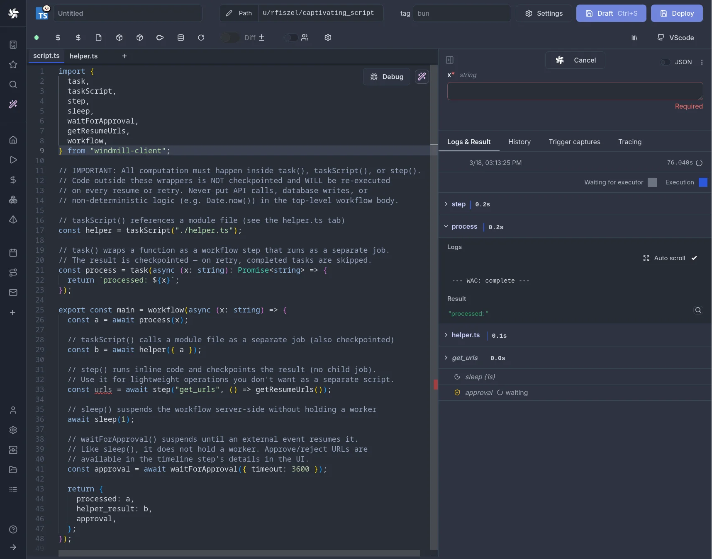

import DocCard from '@site/src/components/DocCard';
import { BenchmarkVisualization } from '@site/src/components/BenchmarkVisualization';

# Alternative to Prefect for building workflows


Both Windmill and Prefect support writing complex workflows and ETL with code and run them at scale.
We highlight below the main differences between the 2 on the following axis:

- [What you can build](#what-you-can-build)
- [Target users and languages](#target-users-and-languages)
- [Open source and hosting](#open-source-and-hosting)
- [Workflows and code](#workflows-and-code)
  - [Execution model](#execution-model)
  - [Local development and Git](#local-development-and-git)
- [Triggers](#triggers)
- [Integrations](#integrations)
- [Execution runtime and coldstarts](#execution-runtime-and-coldstarts)
  - [Example benchmark](#example-benchmark)
  - [Dispatch and per-task overhead](#dispatch-and-per-task-overhead)
- [Observability and monitoring](#observability-and-monitoring)
- [Security, audit logs and multi-tenancy](#security-audit-logs-and-multi-tenancy)
- [Migration and lock-in](#migration-and-lock-in)
- [Windmill AI](#windmill-ai)
- [Pricing](#pricing)
- [Scripts and apps](#scripts-and-apps)
- [When Prefect is a good fit](#when-prefect-is-a-good-fit)

<a href="https://www.prefect.io/" rel="nofollow"> Prefect </a> is a data workflow management system, designed to help teams build, run, and monitor data workflows. It provides tools for orchestrating data pipelines, managing their execution, and ensuring data integrity.

For a visual side-by-side of both products, see the [Windmill vs Prefect comparison page](/compare/prefect).

## What you can build

Windmill is an open-source workflow engine and developer platform to build and orchestrate internal software: [scripts](/use-cases/scripts), [workflows](/use-cases/workflows), [data pipelines](/use-cases/data-pipelines), [AI agents](/use-cases/ai-agents) and [internal apps](/use-cases/internal-apps).
It is made for engineers who want full code flexibility and a [local dev experience](/platform/local-dev), both to build internal software and to manage the underlying infrastructure.

Prefect is an open-source Pythonic workflow orchestrator for data pipelines.
Flows and tasks are plain Python functions decorated with `@flow` and `@task`, with a UI for runs, schedules and state.
It is aimed at Python-first data teams that want code-native workflows without a separate DSL.

Both platforms orchestrate workflows.
The difference is what else you can build on the same runtime.
Windmill runs scripts, workflows, data pipelines, full-code apps, AI agents and operator UIs on a single runtime, with shared resources, auth and observability.
Prefect focuses on Python workflow orchestration, so you bring your own stack for dashboards, internal apps, agent front-ends and non-Python workloads.

| Primitive | Windmill | Prefect |
| --- | --- | --- |
| [Workflows](/use-cases/workflows): chain scripts into flows with branching, retries and approval steps | Yes | Yes |
| [Data pipelines](/use-cases/data-pipelines): ETL, syncs and scheduled data jobs with parallel branches | Yes | Yes |
| [Scripts](/use-cases/scripts): standalone functions exposed as APIs, webhooks or cron jobs without a wrapping flow | Yes | No |
| [AI agent workflows](/use-cases/ai-agents): agents that call tools, branch on outputs and run as workflows | Yes | Partial |
| [AI sandboxes and volumes](/platform/sandboxes): isolated environments with persistent volumes for running agents | Yes | No |
| [Low-code internal apps](/use-cases/internal-apps): drag-and-drop dashboards and admin tools with built-in components | Yes | No |
| [Full-code internal apps](/platform/app-builder): custom dashboards and admin tools built in React or Svelte | Yes | No |
| [Scheduled tasks](/use-cases/scheduled-tasks): cron jobs with retries, error handling and alerting | Yes | Yes |

## Target users and languages

Windmill is built for developer-led teams across languages.
Engineers own the platform end-to-end: code in TypeScript, Python, Go, Bash, SQL and more, with Git, local dev, [workspace forks](../advanced/20_workspace_forks/index.mdx), code review, CI/CD, AI coding tools and infrastructure as code.
TypeScript, Python, Go, Bash, SQL, PHP, Rust, C# and any Docker image are first-class script languages with shared resources, auth and observability.
Each language is a native script primitive with its own UI, API and scheduler, so running a TypeScript script, a SQL query or a Bash command needs no wrapping layer.

Prefect is designed for Python-first data teams.
Data engineers and data scientists who already work in Python get a focused authoring model through `@flow` and `@task` decorators, with the flow and its tasks running in the same Python process by default.
Prefect flows and tasks are Python functions: there is no YAML authoring layer, no multi-language support and no visual no-code editor.
Non-Python code runs through `subprocess` or shell tasks inside a Python flow.
That is fine for an occasional helper, and a heavier lift if your team is polyglot: teams with Node, Go, Bash or SQL heavy workloads either wrap them in Python subprocess calls or use a different orchestrator.

## Open source and hosting

[Windmill](https://www.windmill.dev/)'s core is open source under AGPLv3, with Enterprise features in a separate proprietary codebase. The open-source edition can be self-hosted with just a few commands.

Windmill offers a clean slate, allowing you to fully explore its platform before committing to the product.
Windmill's open-source nature ensures that the platform is tested, approved, and continuously enhanced
to meet the community's needs.

Windmill provides and integrates into its platform a [public community Hub](https://hub.windmill.dev/) where users share useful and proven scripts, flows, and applications.


<div className="grid grid-cols-2 gap-6 mb-4">
	<DocCard
		title="Windmill's GitHub"
		description="Windmill's official repository."
		href="https://github.com/windmill-labs/windmill"
	/>
	<DocCard
		title="Self-host Windmill"
		description="Self host Windmill in 2 minutes."
		href="/docs/advanced/self_host/"
	/>
	<DocCard
		title="Contributor guide"
		description="How to help: Windmill Hub, issues, feature requests and our Discord."
		href="/docs/misc/contributing"
	/>
</div>

Prefect has an Apache v2.0 License and can be self-hosted.

Windmill's open-source core is AGPLv3, which requires source availability for network-exposed modifications.
Prefect's Apache 2.0 core is more permissive if you plan to modify and redistribute.
Both are free to self-host for unmodified use.
If license permissiveness of the core is a hard constraint, Prefect is ahead on this point.

Windmill's [Enterprise Edition](/pricing) is self-hostable.
Prefect's enterprise-grade features (RBAC, SSO, audit logs, multi-tenancy, service accounts) live in the proprietary <a href="https://www.prefect.io/pricing" rel="nofollow">Prefect Cloud</a> SaaS, not in a self-hostable Enterprise build.

Prefect open source includes a self-hostable server with a UI for runs, deployments and schedules, and event-based automations: Prefect 3 can run deployments in response to events without Prefect Cloud.
User accounts, workspaces, RBAC, SSO and audit logs are Prefect Cloud features.

## Workflows and code

Prefect and Windmill Flow editor have a very similar sets of features. Below are the advanced features presented by Prefect and, in backlink, their counterpart on Windmill:

- [scheduling](../core_concepts/1_scheduling/index.mdx)
- [retries](../flows/14_retries.md)
- [logging](../core_concepts/14_audit_logs/index.mdx)
- [convenient async functionality](../core_concepts/4_webhooks/index.mdx#asynchronous)
- [caching](../flows/4_cache.mdx)
- [notifications](../core_concepts/1_scheduling/index.mdx#be-notified-every-time-a-scheduled-workflow-has-been-executed)
- [observability](../core_concepts/5_monitor_past_and_future_runs/index.mdx)
- [event-based orchestration](../triggers/index.mdx)

We could also mention [storage of configuration](../core_concepts/3_resources_and_types/index.mdx) or [error handling](../core_concepts/10_error_handling/index.mdx) that are dealt with in a similar manner.


Prefect is heavily code-based. Everything is and can only be defined in Python. The steps and their configurations are defined by code:


> [Flow](#example-benchmark) "_Given a GitHub repository, logs the number of stargazers and contributors for that repo_" on Prefect.

<br />

The flow, its tasks and the orchestration wiring all live in the same Python file.
Deployment metadata (schedules, work pools, parameters) sits in a separate `prefect.yaml` or is declared from Python.
The Prefect UI surfaces deployments, runs and logs, while authoring stays in your IDE.

Windmill offers both low-code and code-based solutions.


### Flow editor

In Windmill's [Flow editor](../flows/1_flow_editor.mdx), the steps are also code-based but built from scripts ([TypeScript](../getting_started/0_scripts_quickstart/1_typescript_quickstart/index.mdx), [Python](../getting_started/0_scripts_quickstart/2_python_quickstart/index.mdx), [Go](../getting_started/0_scripts_quickstart/3_go_quickstart/index.mdx), [Bash](../getting_started/0_scripts_quickstart/4_bash_quickstart/index.mdx), [SQL](../getting_started/0_scripts_quickstart/5_sql_quickstart/index.mdx) ...). Users can write the code directly, choose a script from the workspace, the community library [WindmillHub](https://hub.windmill.dev/), or have it [generated with AI](#windmill-ai). Each script can be saved with [permissions](../core_concepts/16_roles_and_permissions/index.mdx) set from the workspace.

The structuring of the flow and the configurations for each step are defined from a User Interface. With a _code when you need_ mindset, the user can navigate the flow editor in low-code.

The visual editor composes steps as a DAG with built-in branches, loops, error handlers and approval steps, and is backed by YAML.
Data passes between steps through `results.step_name` expressions.
Each step is a real script, edited and triggered in the same surface as the flow.


> [Flow](#example-benchmark) "_Given a GitHub repository, logs the number of stargazers and contributors for that repo_" on Windmill.

<br />

In particular, Windmill [generates automatically UIs](../core_concepts/6_auto_generated_uis/index.mdx) for flows and steps and lets users [test](../core_concepts/23_instant_preview/index.mdx) flows, steps or flow until a given step, from the UI.

Flows can be [defined visually / YAML](../advanced/4_local_development/index.mdx) on a local environment. In particular, Windmill has a [VS Code extension](../cli_local_dev/1_vscode-extension/index.mdx) to edit from your code editor scripts flows YAML.

<div className="grid grid-cols-2 gap-6 mb-4">
	<DocCard
		title="VS Code extension"
		description="Build scripts and flows in the comfort of your VS Code or Cursor editor, while leveraging Windmill UIs for test & flows edition."
		href="/docs/cli_local_dev/vscode-extension"
	/>
</div>

### Workflows as code

[Flows](#flow-editor) are not the only way to write distributed programs that execute distinct jobs. Another approach is to write a program that defines the jobs and their dependencies, and then execute that program. This is known as [workflows as code](../core_concepts/31_workflows_as_code/index.mdx).



Windmill supports defining workflows as code in a single script in both [Python](../getting_started/0_scripts_quickstart/2_python_quickstart/index.mdx) and [TypeScript](../getting_started/0_scripts_quickstart/1_typescript_quickstart/index.mdx) using intuitive and lightweight syntax.

Here is an example of a workflow as code with Prefect (from their <a href="https://docs.prefect.io/latest/concepts/tasks/" rel="nofollow">documentation</a>):

```python
from prefect import flow, task

@task
def my_first_task(msg):
    print(f"Hello, {msg}")

@task
def my_second_task(msg):
    my_first_task.fn(msg)

@flow
def my_flow():
    my_second_task("Trillian")
```

and the same example with [Windmill](../core_concepts/31_workflows_as_code/index.mdx) (in Python):

```python
from wmill import task

@task
def my_first_task(msg):
    print(f"Hello, {msg}")

@task
def my_second_task(msg):
    my_first_task(msg)

def main():
   my_second_task("Trillian")
```

Windmill workflows as code use native try/catch, parallel branches and the language's own control flow.
They are authored, run and inspected in the Windmill UI, with no separate SDK or worker process to deploy.

### Execution model

Windmill has two ways to define workflows and one runtime under both: the visual [flow editor](#flow-editor) and [workflows as code](#workflows-as-code) in Python or TypeScript.
In the workflow-as-code engine, two step primitives carry different cost profiles:

- `task()` dispatches a child job in a separate process and surfaces as its own job in the UI, for steps that need isolation or independent retries.
- `step()` runs inline in the same process and checkpoints its result to Postgres in roughly 0.5ms, for cheap units like a calculation, a CSV parse or a small DB query.

Prefect uses a hybrid model.
The flow and its tasks execute in the same Python process by default, so data passes through Python variables.
Each task run is tracked by the Prefect API server through HTTP calls and Postgres writes for every state transition (Pending, Running, Completed).
Concurrency uses Python futures via `.submit()`, running tasks in a thread or process pool, with the GIL as the limit for CPU-bound parallelism.

### Local development and Git

Windmill scripts run locally with the [Windmill CLI](../advanced/3_cli/index.mdx), alongside the VS Code extension, native language tooling (LSP, type-checking, linting) and AI coding tools (Claude Code, Codex).
Scripts, flows, apps, resources, variables, secrets, schedules, folders, groups and permissions are all files in Git, deployed via the CLI and [Git sync](../advanced/11_git_sync/index.mdx).
Internal tooling then follows the same process as application code: PRs, reviews, rollbacks, CI/CD.
On self-hosted Community Edition, Git sync is free for up to 2 users; beyond that it requires the Enterprise Edition.

Prefect uses standard Python tooling: VS Code, PyCharm, pytest, type-checkers and any linter.
The `prefect` CLI starts a local server and runs flows end-to-end before deploy.
A Prefect project lives in Git, and deployments go out through the `prefect` CLI or CI pipelines, with flow code pulled from a repo at runtime.
Users, RBAC and workspaces are configured in the Prefect Cloud UI and are not version-controlled alongside the code.

## Triggers

Prefect uses a deployment system from the terminal to trigger and schedule its flows.

To manage its triggers from the Prefect UI, you have to go through a separate menu called <a href="https://docs.prefect.io/latest/concepts/automations/" rel="nofollow">Automations</a> and go through many actions before actually triggering the flow.

While Windmill also allows configuration and triggers from the terminal, the platform is designed to schedule, manually trigger, generate webhooks or UIs from the Windmill UI (cloud or self-hosted).

Windmill has native [triggers](../triggers/index.mdx) for HTTP, cron, Kafka, NATS, Postgres CDC, SQS, MQTT, SMTP and WebSocket.
Each trigger is a typed primitive in the UI: configure the topic, subject or path, attach it to a script or flow, and Windmill handles the connection, replay and consumer-group state.
Every script also gets an HTTP endpoint and a webhook URL, so most receive paths need no glue code.
[Kafka](../triggers/5_kafka_triggers/index.mdx), [NATS](../triggers/6_nats_triggers/index.mdx) and [SQS](../triggers/7_sqs_triggers/index.mdx) triggers are self-hosted Enterprise features, and [Postgres](../triggers/4_postgres_triggers/index.mdx) and [MQTT](../triggers/8_mqtt_triggers/index.mdx) triggers are not available on Windmill Cloud.

Prefect open source has cron and interval schedules and event-based automations; webhooks are Prefect Cloud.
It has no native Kafka, Postgres CDC or SQS trigger: those are typically polled from inside a flow.

<video
	className="border-2 rounded-lg object-cover w-full h-full dark:border-gray-800"
	controls
	src="/videos/schedule-cron-menu.mp4"
/>
<br />

> Example of a flow scheduled manually via the UI on Windmill.

<br />

<div className="grid grid-cols-2 gap-6 mb-4">
	<DocCard
		title="Triggers"
		description="Trigger scripts and flows on-demand, by schedule or on external events."
		href="/docs/triggers"
	/>
</div>

## Integrations

### Connecting to external systems

In Windmill, any npm, PyPI, Go or Maven package is a first-class import with automatic per-script dependency resolution and lockfiles, and no plugin layer in between.
You call the vendor's SDK directly, with type inference and auto-completion in the editor.
For example, type `import stripe` in the script editor and run: Windmill detects the import, resolves the version and pins it in a per-script lockfile, with no venv, no `pip install` and no restart.
[50+ pre-built resource types](../integrations/0_integrations_on_windmill.mdx) cover common databases (Postgres, Snowflake, BigQuery), SaaS (Slack, Stripe, GitHub, Notion, OpenAI) and infrastructure (S3, Redis, Kafka).
Paste an API key into a typed form and the resource is shared across scripts, flows and apps, encrypted at rest.
The community [Hub](https://hub.windmill.dev/) has reusable scripts and flows for common tasks.

Prefect lists 20 <a href="https://docs.prefect.io/integrations/" rel="nofollow">integration packages</a>, 17 of them maintained by Prefect (`prefect-aws`, `prefect-gcp`, `prefect-dbt`, `prefect-snowflake`, `prefect-databricks`, `prefect-kubernetes`) installed as regular pip packages.
Each ships pre-built `@task` wrappers around the vendor SDK and Blocks (typed config classes that hold connection info and credentials).
Any other pip package works the same way: install it into the venv and import it inside a task.
Each `python flow.py` run re-imports the venv, so new packages are picked up on the next run with no restart.

Windmill does not maintain a parallel catalog of integration packages: you call the vendor's SDK (boto3, google-cloud-storage, snowflake-connector-python) directly.
For teams who want curated, opinionated connectors for mainstream data tools, Prefect's catalog is often easier to get started with.

### Resources and secrets

In Windmill, [resources](../core_concepts/3_resources_and_types/index.mdx) (typed JSON for credentials, connection info, configs) and [variables](../core_concepts/2_variables_and_secrets/index.mdx) (individual secrets) are first-class and reusable across scripts, flows and apps.
They are encrypted at rest, scoped via folders and groups for access control, and versioned in Git.
External secret backends (Vault, AWS Secrets Manager) are Enterprise Edition.

In Prefect, <a href="https://docs.prefect.io/v3/concepts/blocks" rel="nofollow">Blocks</a> hold typed configuration and credentials, with `SecretStr` fields encrypted at rest.
Pre-built blocks cover AWS, GCP, Azure, Snowflake, Databricks and other common services.
The `prefect-aws` integration reads AWS Secrets Manager through its `AwsSecret` block, in open source as in Prefect Cloud.

### Extending

In Windmill, a new integration is a script with a new import: save and run, with no restart and no image rebuild.
This works the same in the web editor, the CLI and Git sync.
Custom logic can be exposed as a typed script, packaged as a resource type for shared use, or, on [Enterprise Edition](../core_concepts/32_private_hub/index.mdx), published to a private Hub for the team.

In Prefect, when there is no official integration for what you need, you import the vendor SDK directly in a task, or write your own block type and task collection.
Community integrations are published as standalone pip packages.

## Execution runtime and coldstarts

Windmill's architecture allows running each task on the current fleet of worker
(which you can auto-scale automatically) and hence do not suffer from cold start.
Isolation and creating dedicated dependency environment is the secret sauce that makes Windmill
the fastest execution runtime for scripts (10ms cold start).

Windmill can run 26M tasks a month on a single worker costing 5$. Prefect does not provide figures on its average runtime and performance.

Also, Windmill has a [transparent API](https://app.windmill.dev/openapi.html#/), on which you could imagine launching 1m simulateously by API.

We have conducted [benchmarks](../misc/3_benchmarks/index.mdx) to measure our performance against our competitors.

<div className="grid">
		<BenchmarkVisualization
		usecase="fibonacci_40_10"
		language="python"
		engines={['airflow', 'kestra', 'prefect', 'temporal', 'windmill', 'hatchet', 'windmill_dedicated']}
		workers={1}
		title="40 lightweight tasks comparison"
		maintainAspectRatio={false}
	/>
</div>

<div className="grid grid-cols-2 gap-6 mb-4">
	<DocCard
		title="Benchmarks"
		description="Comparing performance of Airflow, Prefect, Temporal, Kestra, Hatchet and Windmill"
		href="/docs/misc/benchmarks/competitors"
	/>
</div>

For comparison, you will find below a test between Prefect and Windmill for cold start, execution, and result of an [example flow shared by Prefect](#example-benchmark).

Each instance is self-hosted.

### Example benchmark

Flow "Given a GitHub repository, logs the number of stargazers and contributors for that repo", <a href="https://docs.prefect.io/latest/getting-started/quickstart/#step-3-write-a-flow" rel="nofollow">shared by Prefect</a> on their quickstart (measured in September 2023):


- Prefect: Cold start + Execution + Results = 8.09s
- Windmill: Cold start + Execution + Results = 1.13s

<video
	className="border-2 rounded-lg object-cover w-full h-full dark:border-gray-800"
	controls
	src="/videos/windmill_prefect_flow.mp4"
/>

<br />

For up-to-date numbers across engines, refer to the regularly refreshed [benchmarks](../misc/3_benchmarks/competitors/index.mdx).

Trust but verify: to ensure the performance of Windmill's workers and measure their capabilities,
we provide a benchmarking tool. This tool allows you to benchmark the execution of jobs and flows,
providing insights into the performance metrics.

<div className="grid grid-cols-2 gap-6 mb-4">
	<DocCard
		title="Benchmarks Folder"
		description="This folder includes a small deno/ts utility to benchmark execution of jobs and flows."
		href="https://github.com/windmill-labs/windmill/tree/main/benchmarks"
	/>
	<DocCard
		title="OpenAPI"
		description="Interact with Windmill."
		href="https://app.windmill.dev/openapi.html"
	/>
</div>

### Dispatch and per-task overhead

Windmill workers poll Postgres directly with `SELECT ... FOR UPDATE SKIP LOCKED` and self-schedule.
There is no separate scheduler process, no broker and no extra polling interval on the dispatch path.
[Dedicated workers](../core_concepts/25_dedicated_workers/index.mdx) (Enterprise Edition or Windmill Cloud) keep the runtime and dependencies pre-warmed.
Arguments pass directly between steps, and results are checkpointed as JSONB in Postgres.

In Prefect, per-task overhead comes from state tracking: every task run hits the Prefect API server with an HTTP call for each state transition (Pending, Running, Completed), with each transition persisted to Postgres.
For high-volume short tasks the HTTP and database round-trips dominate.
For heavy-duty tasks that run for minutes, the per-task overhead is a rounding error and the gap between the two platforms disappears.

Prefect tasks run in the same Python process as the flow by default, so a worker holds the process for the duration of the flow.
`time.sleep(60)` inside a flow holds the worker for those 60 seconds.
`suspend_flow_run` tears down the flow's infrastructure and resumes it when input arrives, but there is no durable timed sleep that resumes the flow on its own.
A mid-task crash loses in-task progress, since retries restart the task from the beginning.

## Observability and monitoring

In terms of monitoring and observability, Windmill and Prefect's cloud app fulfill the same functions: audit logs, monitoring of runs and schedules, saving of flows, configurations (<a href="https://docs.prefect.io/latest/concepts/blocks/?h=blocks" rel="nofollow">Blocks</a> in Prefect, [Resource types](../core_concepts/3_resources_and_types/index.mdx) in Windmill) and variables, [allocation of workers](../core_concepts/9_worker_groups/index.mdx).

The main difference is that Prefect's application seems to be conceived as a reliable source for reporting actions from Prefect, whereas with Windmill, the application provides more control as everything can be done from the Windmill app (creation of scripts, flows apps, triggers, monitoring, [permissions](../core_concepts/16_roles_and_permissions/index.mdx), etc.)

Windmill provides [real-time streaming logs](/platform/observability), per-run inputs, outputs and duration, built-in worker queue metrics, and a trace ID on every job.
In Prefect, OpenTelemetry export and advanced dashboards are Prefect Cloud only.

<video
	className="border-2 rounded-lg object-cover w-full h-full dark:border-gray-800"
	controls
	id="monitoring"
	src="/videos/runs-menu.mp4"
/>

<br />

<div className="grid grid-cols-2 gap-6 mb-4">
	<DocCard
		title="Roles and permissions"
		description="Control access and manage permissions within your instance and workspaces."
		href="/docs/core_concepts/roles_and_permissions"
	/>
	<DocCard
		title="Jobs runs"
		description="Get an aggregated view of past and future runs on your workspace."
		href="/docs/core_concepts/monitor_past_and_future_runs"
	/>
	<DocCard
		title="Audit logs"
		description="Windmill provides audit logs for every operation and action that has side-effects."
		href="/docs/core_concepts/audit_logs"
	/>
	<DocCard
		title="Workers and worker groups"
		description="Worker Groups allow users to run scripts and flows on different machines with varying specifications."
		href="/docs/core_concepts/worker_groups"
	/>
</div>

## Security, audit logs and multi-tenancy

Windmill's SOC 2 Type II report covers the Enterprise Edition.
RBAC, SSO (up to 10 users), encrypted secrets at rest and sandboxed script execution are available in open source.
Uncapped SSO, [audit logs](../core_concepts/14_audit_logs/index.mdx) (a trail of who ran, edited or deployed what) and advanced access controls (SCIM, SAML) are Enterprise Edition.
Multiple isolated [workspaces](../core_concepts/16_roles_and_permissions/index.mdx#workspace) run on the same instance, each with its own users, resources, secrets and access controls.
The self-hosted Community Edition is capped at 3 workspaces; unlimited workspaces are Enterprise Edition.

Prefect open source ships basic auth only.
RBAC, object-level permissions, custom roles, SSO (SAML / OIDC), SCIM and audit logs are Prefect Cloud only, and Prefect Cloud is SOC 2 compliant.
Prefect open source is single-tenant, and tenant isolation is Prefect Cloud only.

## Migration and lock-in

### Moving from Prefect to Windmill

Windmill is not a drop-in replacement for Prefect, but both platforms handle workflow orchestration with a queue-and-worker architecture, so the mental model transfers.
There is no automated Prefect-to-Windmill converter today.
In practice, the body of each Prefect task ports over as standard Python.
The `@flow` and `@task` decorators and the orchestration wiring are rewritten as Windmill scripts linked together in the [flow editor](#flow-editor).
Prefect-specific features (blocks, deployments, states, automations) are reimplemented using Windmill [resources](../core_concepts/3_resources_and_types/index.mdx), [triggers](../triggers/index.mdx) and flows.
Most ported flows end up shorter because Windmill passes arguments directly between steps and [auto-generates input UIs](../core_concepts/6_auto_generated_uis/index.mdx).

To bring a function into Windmill, paste its body into the [script editor](../script_editor/index.mdx): Windmill infers the arguments, generates a UI and handles dependencies, with no wrapper or decorator to learn.
Triggers, schedules, variables and apps migrate one by one.

Getting into Prefect is straightforward if you already think in Python decorators (or DAGs, from Airflow): wrap existing Python functions with `@flow` and `@task`, declare deployments in `prefect.yaml` and push to a work pool.

### Leaving either platform

Task bodies port cleanly off either platform.
Windmill step logic is standard code (TypeScript, Python, Go, Bash, SQL) inside a thin `main()` wrapper that runs anywhere.
The CLI exports the full workspace as plain files, and the rest of the workspace (flows, resources, schedules, permissions) is YAML in Git that maps to standard concepts.
What you lose when leaving Windmill is the runtime, not the step code.

A Prefect `@task` stripped of its decorator is a plain Python function that runs anywhere.
What needs rewriting is the Prefect-specific layer: blocks, deployments, state handling, automations, work pools, futures, retry config and `flow.serve()` / `flow.deploy()`.

## Windmill AI

Windmill provides ways to have AI help you in your coding experience. From prompts, generate scripts that interact with your integrations, or flows where the AI manages the data transmission between steps, or even automatic error resolution.

<video
	className="border-2 rounded-lg object-cover w-full h-full dark:border-gray-800"
	controls
	src="/videos/flow_ai_builder.mp4"
/>

<br />

<div className="grid grid-cols-2 gap-6 mb-4">
	<DocCard
		title="AI chat & copilots"
		description="AI chat and in-editor copilots for scripts, flows and apps, plus model providers and settings."
		href="/docs/core_concepts/ai_generation"
	/>
</div>

## Pricing

Windmill has a [transparent pricing policy](/pricing), with clear steps for implementation.

Windmill is cheaper at scale and can be used for free at any scale thanks to its open source nature.

Windmill publishes its Enterprise pricing, based on seats and compute units, on its [pricing page](/pricing), with no sales call needed.

As of November 18, 2024, Prefect does not disclose its Enterprise pricing (see below).

Prefect pricing:


<div className="grid grid-cols-2 gap-6 mb-4">
	<DocCard
		title="Pricing"
		description="Windmill's subscription plans and simulations."
		href="/pricing"
	/>
	<DocCard
		title="Plans & How to Upgrade"
		description="Windmill transparently provides the content and pricing of its upgraded plans."
		href="/docs/enterprise/plans_details"
	/>
</div>

## Scripts and apps

This document has focused on the Flow editor since it is the product closest to what Prefect does. However, Windmill also includes Script and App editors.

The [script editor](../script_editor/index.mdx) allows users to build long-running heavy background jobs, script with complex dependencies, endpoints with high rpm or simple one-off tasks without any overhead. They can be triggered them from a webhook, auto-generated UIs, flows, apps etc.


<div className="grid grid-cols-2 gap-6 mb-4">
	<DocCard
		title="Scripts quickstart"
		description="Scripts are the basic building blocks that can be written in TypeScript, Python, Go, PHP, Bash, C#, SQL and Rust or launch docker containers."
		href="/docs/getting_started/scripts_quickstart"
	/>
</div>

The [low-code app editor](../apps/0_app_editor/index.mdx) goes beyond auto-generated UIs and allows you to create your own customized UIs using drag-and-drop from components powered by Windmill scripts and flows. For full control, [full-code apps](../full_code_apps/index.mdx) let you build custom frontends with React or Svelte connected to Windmill backend runnables.


<div className="grid grid-cols-2 gap-6 mb-4">
	<DocCard
		title="Apps quickstart (low-code)"
		description="Apps are customized, user-friendly interfaces built using a drag-and-drop editor."
		href="/docs/getting_started/apps_quickstart"
	/>
	<DocCard
		title="Full-code apps"
		description="Build custom frontends with React or Svelte connected to Windmill backend runnables."
		href="/docs/full_code_apps"
	/>
</div>

## When Prefect is a good fit

Prefect can be a good fit if the scope you need is Python workflow orchestration on its own: a Python-only team, scheduled data pipelines that run for minutes per task, and a preference for tasks running in the same Python process so values pass through variables.
Within that scope, the platform stays focused and consistent.

Prefect is also ahead on two points covered above: its Apache 2.0 core is more permissive than Windmill's AGPLv3 core for redistribution (see [open source and hosting](#open-source-and-hosting)), and its curated first-party packages are often easier to get started with for mainstream data tools (see [integrations](#integrations)).

If you are deciding between the two, the fastest way to judge is to spend an afternoon in each.

In conclusion, Prefect is an excellent tool for building workflows and heavy data ETL. From Windmill's perspective, Prefect's flows don't lack major features.

However, Windmill distinguishes itself from Prefect by providing more control for building and monitoring flows, as well as scripts and UIs, all from a single open-source platform.
