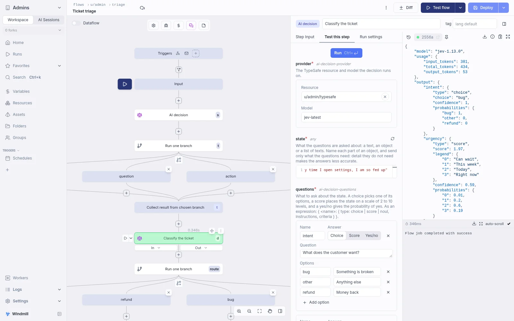
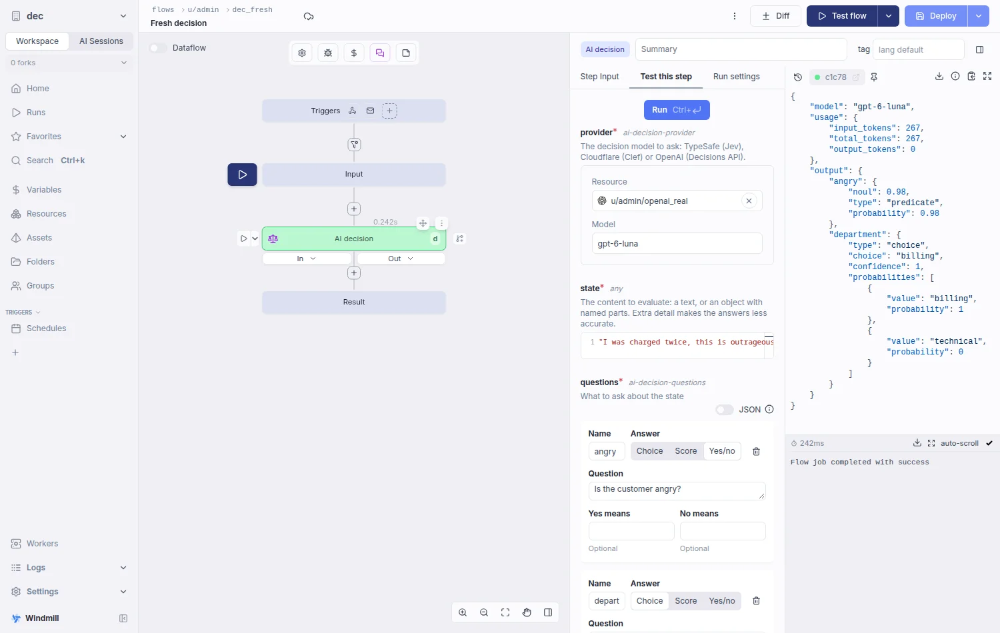
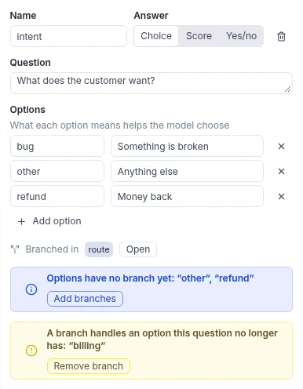

import DocCard from '@site/src/components/DocCard';

# AI decision

An AI decision step asks a decision model typed questions about a state and returns calibrated answers instead of text: a choice with its probabilities, a score on a scale, or the probability of yes.
Use it in a [flow](./1_flow_editor.mdx) to classify, score or check something, and route on the answer with a [Branch to one](./13_flow_branches.md#branch-one).
For anything that needs tools or free text, use an [AI agent](../core_concepts/54_ai_agents/index.mdx) step instead.

Add it from the step menu with "AI Decision".



## Providers

The step runs on one of three decision models:

- [TypeSafe's Jev](https://docs.typesafe.ai/introduction), with a `typesafe` [resource](../core_concepts/3_resources_and_types/index.mdx) holding your TypeSafe API key. The model defaults to `jev-latest`; pin a version such as `jev-1.13.0` to keep a flow tuned against its probabilities.
- Cloudflare's Jev-compatible [Clef](https://developers.cloudflare.com/workers-ai/models/clef-flash/) on Workers AI, with a `cloudflare` resource holding a token and account ID. The model is `clef` (the default) or `clef-flash` for faster answers. A `base_url` on the resource replaces the Workers AI URL, for example to go through an AI Gateway.
- OpenAI's [Decisions API](https://developers.openai.com/api/docs/guides/decisions), with the same `openai` resource as [AI agent](../core_concepts/54_ai_agents/index.mdx) steps. The model is `gpt-6-luna`. Azure OpenAI resources are not supported.

TypeSafe and Cloudflare only answer decisions: an AI agent step refuses them.

## State

The state is what the questions are asked about: a text, an object or an array of strings.
It is usually the text to classify, such as `flow_input.message`.
To combine several values, pass an object with descriptive keys holding only what the questions need:

```js
({ message: flow_input.message, plan: results.get_account.plan })
```

A missing or blank state fails the step before any request is sent.

On OpenAI, a text is sent as is, and a list of user messages (`role: "user"` with a text or `input_text` and `input_image` parts) is passed through, which is the only way to send an image.
Any other object or array is sent as its JSON text.

## Questions

Each question has a name, an answer type and the question itself.
The name is how later steps read its answer.

| Answer type | What you give | What it returns |
| --- | --- | --- |
| Choice | Options, each with an optional description (up to 255 options) | `choice`, `probabilities` and `confidence` |
| Score | An ordered list of 2 to 10 level descriptions | `score`, `legend`, `probabilities` and `confidence` |
| Yes/no | Optional meanings for yes and no | `noul`, the probability of yes, from 0 to 1 |

Toggle the field to JSON to edit the questions directly, or switch it to an expression to compute them.
In JSON, each question name maps to `{ type, instructions, criteria }`, where `type` is `choice`, `score` or `noul`:

```json
{
	"intent": {
		"type": "choice",
		"instructions": "What does the customer want?",
		"criteria": { "refund": "Money back", "bug": "Something is broken", "other": "Anything else" }
	},
	"urgency": {
		"type": "score",
		"instructions": "How urgent is the ticket?",
		"criteria": ["Can wait", "This week", "Today", "Right now"]
	},
	"angry": { "type": "noul", "instructions": "Is the customer angry?" }
}
```

## Result

The step returns `{ output, model, usage }`, with `output` keyed by question name and `model` the version that answered.
A later step with the decision as `triage` reads:

- `results.triage.output.intent.choice`
- `results.triage.output.urgency.score`
- `results.triage.output.angry.noul`

On OpenAI, `probabilities` is a list of `{ value, probability }` and a score has no `legend`.
A question OpenAI refuses to answer fails the step.



## Branching on the answers

Route on the answers with a [Branch to one](./13_flow_branches.md#branch-one) right after the decision.
"Branch on this question" in a choice or yes/no question's card, or "Branch on" followed by the question name beside the step on the graph, inserts it for you:

- A choice question gets one branch per option, on `results.<id>.output.<question>.choice === "<option>"`.
- A yes/no question gets one "yes" branch on `results.<id>.output.<question>.noul >= 0.5`, with the default branch as "no". You can tune the threshold afterwards.

The editor flags options that have no branch yet.



## As an AI agent tool

An AI decision can also be a tool of an [AI agent](../core_concepts/54_ai_agents/index.mdx#ai-decision-tool) step.
The agent's model supplies the state, sees the questions in the tool description, and receives only the answers.

<div className="grid grid-cols-2 gap-6 mb-4">
	<DocCard
		title="Branches"
		description="Split the execution of the flow based on a condition."
		href="/docs/flows/flow_branches"
	/>
	<DocCard
		title="AI agents"
		description="Add AI agent steps with tools to your flows."
		href="/docs/core_concepts/ai_agents"
	/>
</div>
