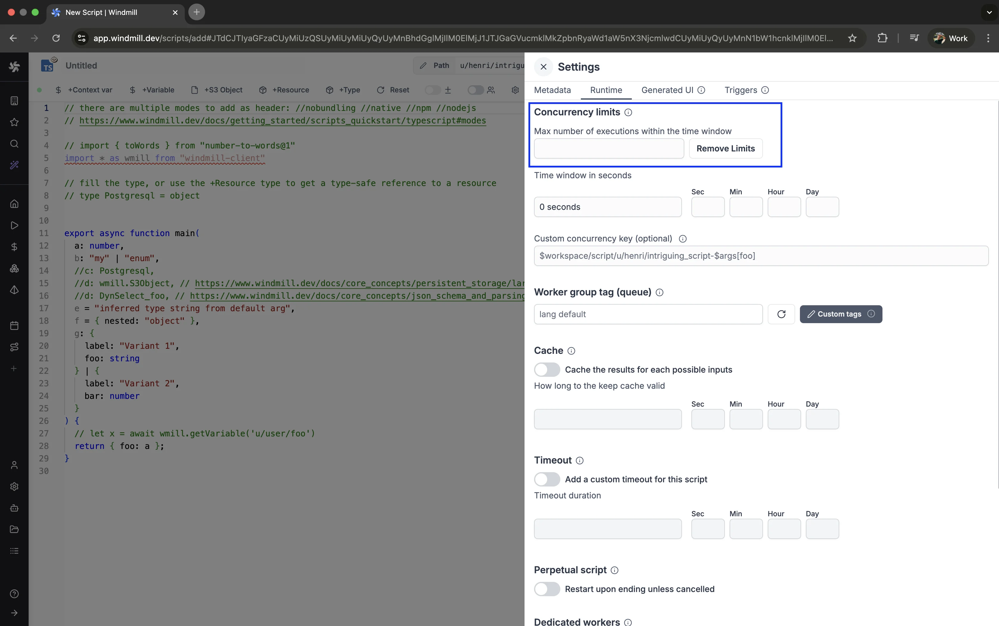

# Concurrency limits

The Concurrency limits feature allows you to define concurrency limits for scripts, flows and inline scripts within flows. Its primary goal is to prevent exceeding the API Limit of the targeted API, eliminating the need for complex workarounds using worker groups.

Concurrency limit is a [Cloud plans and Self-Hosted Enterprise Edition](/pricing) feature.

Concurrency limit can be set from the Settings menu. When jobs reach the concurrency limit, they are by default queued for execution at the next available optimal slot given the time window, or they can [fail at once](../core_concepts/21_concurrency_limits/index.md#when-the-limit-is-reached).

The Concurrency limit operates globally and across flow runs. It involves three key parameters:

## Max number of executions within the time window

The maximum number of executions allowed within the time window. If the number of executions exceeds this limit, the job is queued for execution at the next available optimal slot.

## Time window in seconds

Set in seconds, the time window defines the period within which the maximum number of executions is allowed.

## Custom concurrency key

This parameter is optional. Concurrency keys are global, you can have them be workspace specific using the variable `$workspace`. You can also use an argument's value using `$args[name_of_arg]`.

Jobs can be filtered from the [Runs menu](../core_concepts/5_monitor_past_and_future_runs/index.mdx) using the Concurrency Key.